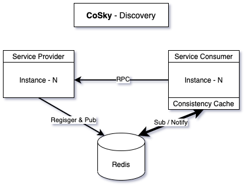

# [CoSky](https://github.com/Ahoo-Wang/CoSky)：基于 Redis 的配置管理与服务发现

<p align="center">
     
</p>

[](https://www.apache.org/licenses/LICENSE-2.0.html)
[](https://github.com/Ahoo-Wang/CoSky/releases)
[](https://central.sonatype.com/artifact/me.ahoo.cosky/cosky-core)
[](https://www.codacy.com/gh/Ahoo-Wang/CoSky/dashboard?utm_source=github.com&amp;utm_medium=referral&amp;utm_content=Ahoo-Wang/CoSky&amp;utm_campaign=Badge_Grade)
[](https://codecov.io/gh/Ahoo-Wang/CoSky)
[](https://github.com/Ahoo-Wang/CoSky)
[](https://deepwiki.com/Ahoo-Wang/CoSky)

> **[中文文档](https://cosky.ahoo.me/zh/)** | [English Documentation](https://cosky.ahoo.me/) | [English README](README.md)

> [!IMPORTANT]
> 这是 6.x 的维护分支，只修复 BUG。CoSky 8.0 在 [`main`](https://github.com/Ahoo-Wang/CoSky/tree/main) 分支上开发。

CoSky 为 Spring Cloud 微服务提供**配置管理**与**服务发现**，基础设施只需要 **Redis**。没有需要运维的注册中心集群：应用直接访问你已经在运行的 Redis；可选的 REST API 服务器提供 Web 控制台、用户与权限管理。

- **从内存读取。** 每个应用持有由 Redis Pub/Sub 保持最新的本地缓存：读取配置或选择实例都不产生网络往返（[基准测试](https://cosky.ahoo.me/zh/guide/performance)）。
- **原子写入。** 每次变更都是单个 Lua 脚本，并通知到每个订阅者。
- **Spring Cloud 原生。** 可实时刷新的属性源、`DiscoveryClient` 与服务注册。

<p align="center">
     
</p>

## 功能

| 领域 | 能力 |
|---|---|
| 配置 | 实时刷新、YAML / properties、版本与回滚、导入导出（兼容 Nacos） |
| 服务发现 | 临时实例自动过期、元数据与状态、加权负载均衡、拓扑 |
| 运维 | REST API 与控制台、JWT 认证、按命名空间授权的角色、审计日志 |
| 隔离 | 用命名空间在同一个 Redis 中隔离环境或租户 |

## 快速开始

添加 starter（`spring-cloud-starter-bootstrap` 让 Spring Cloud 读取 `bootstrap.yaml`）：

```kotlin
dependencies {
    implementation(platform("me.ahoo.cosky:cosky-bom:6.2.0"))
    implementation(platform("me.ahoo.cosky:cosky-dependencies:6.2.0"))
    implementation("me.ahoo.cosky:cosky-spring-cloud-starter-config")
    implementation("me.ahoo.cosky:cosky-spring-cloud-starter-discovery")
    implementation("org.springframework.cloud:spring-cloud-starter-bootstrap")
    implementation("org.springframework.cloud:spring-cloud-starter-loadbalancer")
}
```

在 `bootstrap.yaml` 中指向 Redis：

```yaml
spring:
  application:
    name: order-service          # 加载配置 order-service.yaml，并注册为 order-service
  data:
    redis:
      url: redis://localhost:6379
  cloud:
    cosky:
      namespace: dev
```

运行控制台来管理配置和服务：

```bash
docker run -d --name cosky -p 8080:8080 \
  -e SPRING_DATA_REDIS_URL=redis://host.docker.internal:6379 \
  -e COSKY_SECURITY_KEY="$(openssl rand -base64 32)" \
  ahoowang/cosky:6.2.0
docker logs cosky | grep "init super user"    # 超级用户 "cosky" 的密码
```

[快速开始](https://cosky.ahoo.me/zh/guide/getting-started)指南完整演示了整个过程；[示例](examples)包含一个服务提供者和一个 Feign 消费者。

## 文档

| | |
|---|---|
| [概述](https://cosky.ahoo.me/zh/guide/) | CoSky 是什么、适合什么场景、与同类方案的对比 |
| [配置管理](https://cosky.ahoo.me/zh/guide/configuration) · [服务发现](https://cosky.ahoo.me/zh/guide/service-discovery) · [SDK](https://cosky.ahoo.me/zh/guide/sdk) | 在应用中使用 CoSky |
| [部署](https://cosky.ahoo.me/zh/guide/deployment) · [安全](https://cosky.ahoo.me/zh/guide/security) · [升级到 6.0](https://cosky.ahoo.me/zh/guide/upgrade-6) | 运行 REST API 服务器 |
| [配置属性](https://cosky.ahoo.me/zh/guide/properties) · [REST API](https://cosky.ahoo.me/zh/guide/rest-api) | 参考 |
| [架构](https://cosky.ahoo.me/zh/guide/architecture) · [性能](https://cosky.ahoo.me/zh/guide/performance) | 工作原理 |

## 参与贡献

开发环境、编码规范、评审与发版流程见[贡献指南](CONTRIBUTING.md)；请按 [SECURITY.md](SECURITY.md) 私下报告安全漏洞。所有参与者都应遵守[行为准则](CODE_OF_CONDUCT.md)。

## 许可证

CoSky 基于 [Apache License 2.0](LICENSE) 开源。
