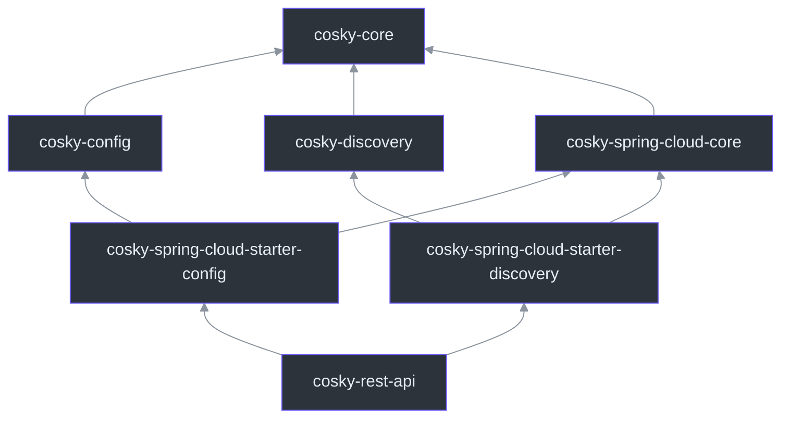
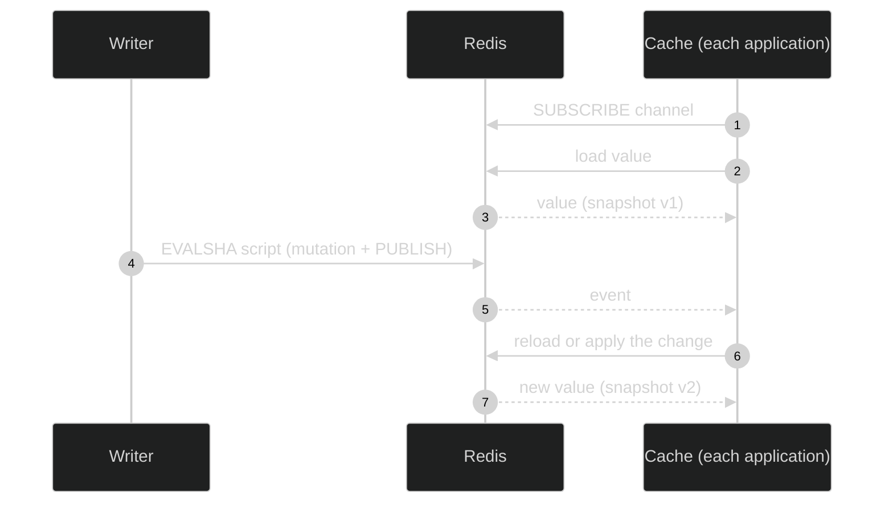

# Architecture

This page explains how CoSky works, for engineers evaluating it, operating it at scale, or contributing to it.

## Principles

1. **Redis is the only infrastructure.** Clients talk to Redis directly; no CoSky server sits on the read or write path of applications.
2. **Every mutation is one Lua script**, so concurrent writers never see partial state, and every mutation announces itself on a Pub/Sub channel.
3. **Applications read from memory.** A local cache follows the change events, so reads cost no round trip and Redis load does not grow with read traffic.

## Modules

| Module | Responsibility |
|---|---|
| `cosky-core` | Namespaces, Redis key helpers, the Lua script loader, event listener containers, and `ReactiveWatchCache`, the consistency cache everything else builds on |
| `cosky-config` | Config storage, versions and rollback (`RedisConfigService`), and its cached view (`RedisConsistencyConfigService`) |
| `cosky-discovery` | Registry, renewal and expiry, discovery and its cached view, load balancers, statistics, topology |
| `cosky-spring-cloud-*` | Spring Boot auto-configuration, Spring Cloud property source, `DiscoveryClient` and service registry |
| `cosky-rest-api` | REST API server and dashboard host: CoSec security, audit log, statistics job |

## Data model

Every key starts with its namespace. Namespaces are wrapped in a Redis Cluster hash tag (`{dev}`), so all keys of a namespace map to one slot and a Lua script can touch several of them.

| Key | Type | Content |
|---|---|---|
| `{ns}:cfg:{configId}` | hash | Current config: `data`, `hash`, `version`, `createTime` |
| `{ns}:cfg_idx` | set | Config ids |
| `{ns}:cfg_htr:{configId}:{version}` | hash | A previous version, with the operation that replaced it |
| `{ns}:cfg_htr_idx:{configId}` | sorted set | History keys by version; the latest 10 are kept |
| `{ns}:svc_idx` | set | Service ids |
| `{ns}:svc_itc_idx:{serviceId}` | set | Instance ids of a service |
| `{ns}:svc_itc:{instanceId}` | hash | Instance fields and metadata; a Redis TTL makes ephemeral instances expire |
| `{ns}:svc_itc_exp` | sorted set | Ephemeral instances by expiry time, to find expired ones without scanning |
| `{ns}:svc_stat` | hash | Instance count per service |
| `{ns}:topology_idx`, `{ns}:topology:{consumer}` | sets | Consumers, and the services each consumes |
| `cosky-{system}:ns_idx` | set | Namespaces listed in the dashboard |
| `cosky-{system}:…` | | Users, roles, login locks and the audit log of the REST API server |

Instance ids are `<serviceId>@<scheme>#<host>#<port>`. Instance metadata keys are stored with a `_` prefix; `__` marks internal fields.

## Writes and events

Each mutation runs as one Lua script and publishes on the channel named after the key it changed:

| Channel | Messages |
|---|---|
| `{ns}:cfg:{configId}` | `set`, `remove`, `rollback` |
| `{ns}:svc_idx` | `set`, `remove` (a service appeared or disappeared) |
| `{ns}:svc_itc:{instanceId}` | `register`, `deregister`, `expired`, `set_metadata`, `renew` (or `renew:<ttlAt>`) |
| `cosky-{system}:role_resource_bind:{role}` | `save`, `remove` |

Scripts share functions through `-- @include` directives resolved when they are loaded, and receive the keys they touch through `KEYS`, so they work unchanged on Redis Cluster and need no Redis Functions or modules.

## Consistency model

Every cached view (configs, services, instances, the security policy, roles) is a `ReactiveWatchCache`. For each key it:

1. **subscribes** to the key's channel and waits until the subscription is active,
2. **loads** the value from Redis, so no change can slip in between,
3. **applies** events one at a time, in order, publishing a new immutable snapshot only when the value actually changes.

Guarantees and limits:

- **Reads are eventually consistent**, typically within milliseconds of a write. A write is visible in Redis immediately; caches follow.
- **Lost messages heal.** Pub/Sub delivers at most once; every cached key is also reloaded every 5 minutes, which bounds the staleness after a missed message.
- **Failures are not cached.** A failed load is retried with backoff (1 s up to 30 s). Meanwhile the last good snapshot keeps being served; only a key that never loaded fails its readers.
- **Snapshots are shared.** A snapshot is prepared once per change and an unchanged value is the very same object, so readers can cache what they derive from it; load balancers reuse their state this way.
- **Cached keys stay.** A key, once read, keeps its subscription for the lifetime of the cache.

## Service discovery

**Expiry.** An ephemeral instance's hash has a Redis TTL, renewed by its client (every 10 s for a 60 s TTL by default). When Redis drops it, nothing would be announced, so each renewal also records the expiry time in `{ns}:svc_itc_exp`. After every renewal round, each client reaps up to 100 instances of its namespaces whose expiry time has passed: if the key is really gone, it removes the instance from its service and publishes `expired`. Reads perform the same cleanup lazily. No server is needed for instances to disappear.

**Renewal events are throttled.** A renewal is published only when the previously published expiry time is about to pass, so a stable fleet produces few events. By default consumers then re-read the instance's TTL; with `renew-event-carries-ttl-at`, the event carries the new expiry time instead (enable it only once every client runs 6.0).

**Expired instances are filtered on read** by comparing their expiry time with the local clock, so consumers do not depend on reaping latency. Keep clocks synchronized (NTP): a client whose clock runs ahead may treat live instances as expired.

## REST API server

The server is a Spring Boot application using the same starters as any application, plus:

- **CoSec** for JWT authentication and policy-based authorization ([Security](./security.md)),
- **Simba** to elect, through Redis, the one instance that refreshes service statistics every 10 seconds,
- **CosId** for distributed id generation.

It keeps no state of its own, so instances can be added and removed freely.

## Trade-offs

| Decision | Benefit | Cost |
|---|---|---|
| Redis as the only store | Nothing new to operate; Redis is fast and familiar | Redis availability and persistence become CoSky's; a Redis outage stops writes (cached reads continue) |
| Client renewal instead of server health checks | No server needed; scales with clients | A hung process that keeps renewing stays registered |
| Local caches fed by Pub/Sub | Reads in nanoseconds, Redis load independent of reads | Eventual consistency; one subscription per watched key |
| Lua scripts for every mutation | Atomicity without distributed locks | Scripts are part of the data contract; changing them needs care across client versions |
| Namespace hash tags | Cluster-safe multi-key scripts | A namespace cannot be spread over several cluster slots |
