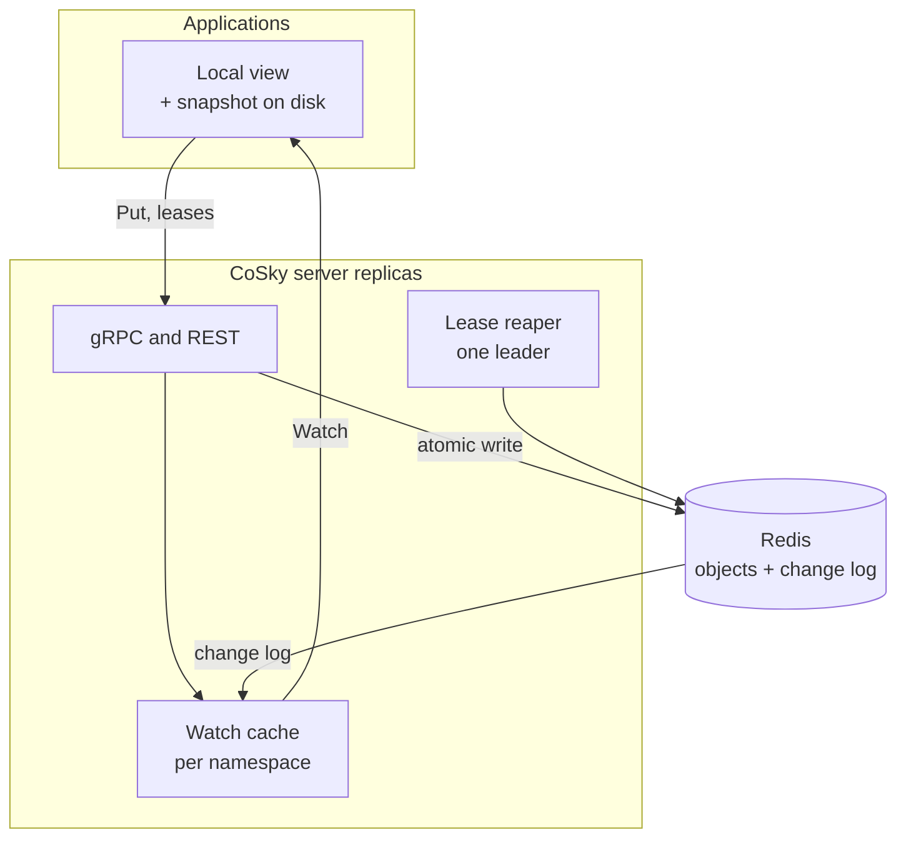

# Architecture

This page explains how CoSky works and what it guarantees. The [design document](https://github.com/Ahoo-Wang/CoSky/blob/main/docs/architecture-redesign.md) has the reasoning behind each decision.

## The data model

Everything is a **Resource**: shared metadata and one spec. A Namespace, Config, Instance, ServiceAccount, Role and RoleBinding are all handled by one API.

A **namespace** is the unit of everything: of isolation, of ordering, and of placement, since it stays in one Redis slot. Each has its own **revision**, a counter that goes up by one with each write. An object remembers the revision that last changed it.

Global kinds live in the reserved namespace `_system`.

## A write

1. The server validates the request and checks permission.
2. One Lua script, atomically: compares the expected revision if asked, gives the namespace its next revision, stores the object, and appends the change to the namespace's log, a Redis Stream.
3. The write is acknowledged.

Writing what is already there changes nothing, and creates no revision.

## Following changes

Each replica follows each namespace's log, and keeps an immutable view of the namespace in memory, plus a window of recent changes. A write publishes a hint, so followers usually read at once. Should a hint be lost, each also polls once a second.

Watchers read those views without any lock. A slow watcher only misses intermediate views, then finds what it missed in the window. It holds back nobody else. If it falls out of the window, it gets `gone` and starts over from a snapshot of what it watches, which is the only cost.

So Redis load grows with the number of namespaces and replicas, and not with the number of clients.

Every 5 minutes, a replica also compares its view with the store. Any difference should be impossible, so it counts as a lost timeline, as below.

## What a client can rely on

- **Order**: changes within a namespace arrive in revision order, and a whole revision at once. Subscribers never see half of one.
- **Delivery**: exactly once within a stream. Across reconnections at least once, and the client drops what it already applied.
- **Resuming**: a client that reconnects to any replica continues from the revision it saw.
- **Reads** are from a local view, so they can be slightly stale. Propagation was [measured](./performance.md) at under 200 ms to 5,000 connections.
- **Writes** go to the primary, and are atomic. `minRevision` lets a REST caller read its own write from any replica.

As a safety net, a client also starts over from a fresh snapshot every 30 minutes or so.

## Leases

A process holds one lease per namespace, and attaches its instances to it, so renewing costs the same however many it has. An Instance without a lease is simply permanent, with no special handling.

One replica at a time runs the **reaper**, under a lock in Redis. It removes the instances of expired leases, with these protections, because removing live instances is worse than keeping dead ones:

1. **Grace**: after becoming leader, or failing to reach the store, it reaps nothing for 30 seconds. Clients have time to reconnect, and an expired lease can still be renewed until it is reaped.
2. **Delay**: a lease is reaped a third of its TTL after expiry. Leases cut off by one partition expire over that span, since they renew at different moments. Reaping at once would remove them one by one, and the next step would never see them together.
3. **Mass expiry**: when more than half of a namespace's leases have expired, and it has at least 10, reaping pauses and logs an error. This covers a partition between clients and servers, which the grace cannot detect. When the share falls, grace starts over. After 5 minutes, it reaps regardless.
4. **Pace**: at most 100 leases per namespace per round.

The cost is that a process that really crashed stays listed for 40 seconds by default. Callers should retry.

## When Redis loses writes

Redis replication is asynchronous, so a failover can lose recent writes, and revisions then go backwards or diverge. Each namespace carries an **epoch**, a random value that changes when this is found, and a position is an epoch and a revision together.

| Detected by | Then |
|---|---|
| The log's position going backwards or missing | Every replica reloads, and every watcher gets `gone` and starts over |
| A client resuming from a revision the store does not have | That client gets `gone` |
| A lease that no longer exists | The client registers everything again |
| The periodic comparison with the store | The epoch is replaced, so all of the above follows |

The system returns to a consistent state, but what Redis lost stays lost. It takes an application to restore a Config, from its history or by writing it again.

## When servers are away

An application keeps serving its local view. On restart, it loads the [snapshot](./sdk.md#snapshots) from disk. Without a snapshot and without a server, an import that is not `optional` fails the start, so that an application does not run without its configuration.

## Why a server at all

CoSky 6.x had applications talk to Redis directly, which left the data plane without authentication, tied every client to one storage layout, and grew Redis's connections with the number of processes. Adding one small server gives authentication on every call, clients for any language, and resumable streams, while reads stay local. The server keeps nothing durable itself, so replicas can come and go.

Redis stays because it is what CoSky is for: for those who already run it, there is nothing new to operate. Those who need more durability should use a system built on consensus.
