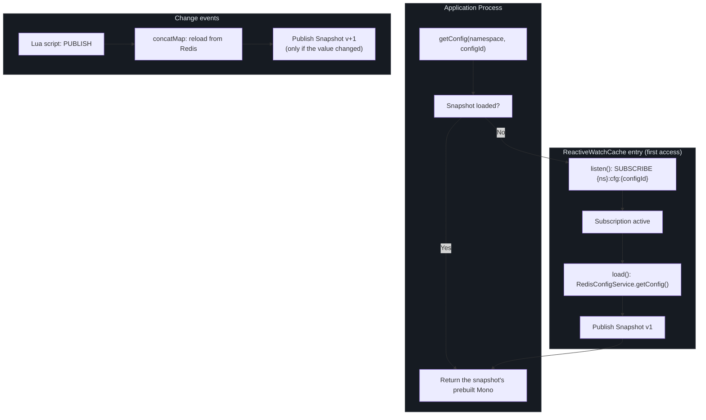
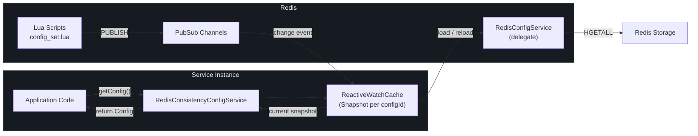
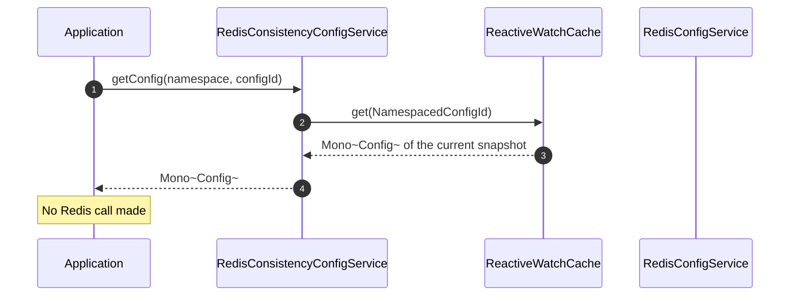
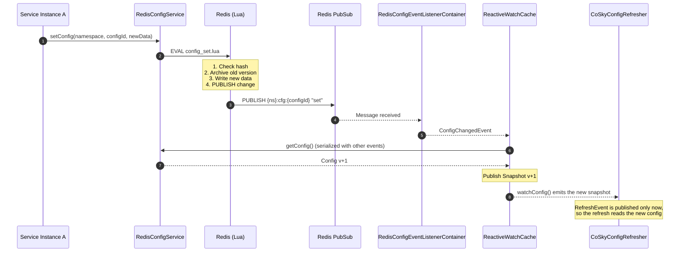
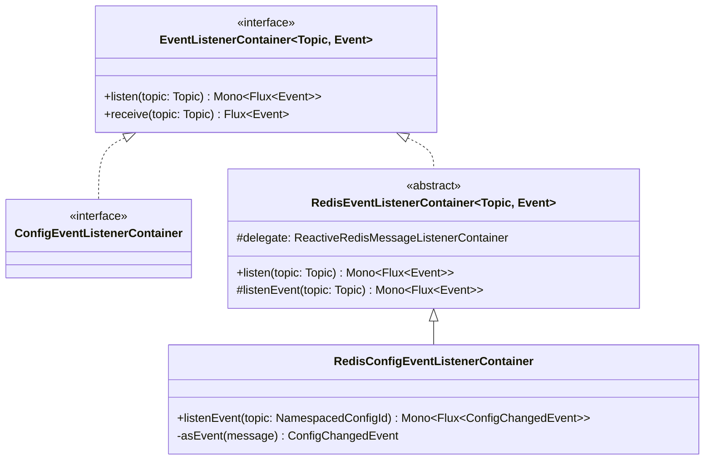
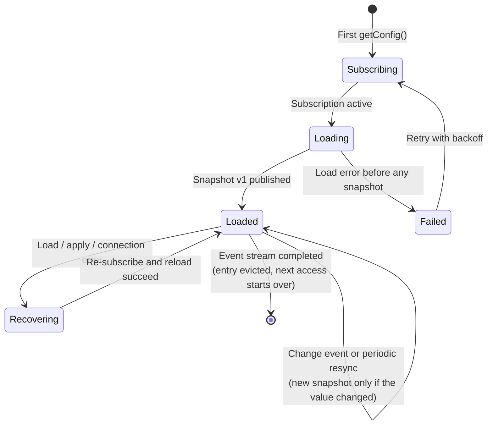
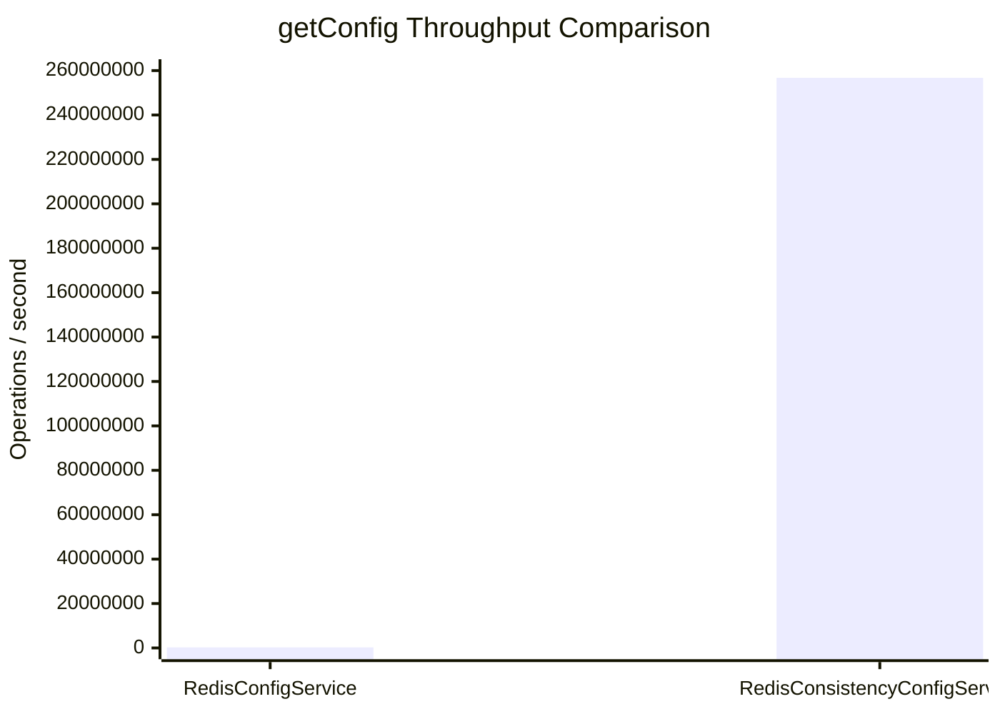

# Consistency Layer

Every `getConfig` call to Redis involves network I/O, serialization, and round-trip latency. At scale with thousands of service instances polling for configuration, this becomes a critical bottleneck -- the raw `RedisConfigService` achieves approximately 241,787 ops/s for reads. CoSky's Consistency Layer solves this by combining a local in-process cache (`ReactiveWatchCache`) with Redis PubSub change events. When a configuration changes, the Lua script that writes the new value also publishes a notification on the config's Redis key channel. All application instances subscribed to that channel receive the event and update their local snapshot. The result: `getConfig` jumps to **256,733,987 ops/s** -- a roughly 1000x improvement -- while maintaining eventual consistency within milliseconds.

## At a Glance

| Component | Responsibility | Key File | Source |
|---|---|---|---|
| **RedisConsistencyConfigService** | Decorator around ConfigService that serves `getConfig` from a `ReactiveWatchCache` | `RedisConsistencyConfigService.kt` | [RedisConsistencyConfigService.kt:36](https://github.com/Ahoo-Wang/CoSky/blob/main/cosky-config/src/main/kotlin/me/ahoo/cosky/config/redis/RedisConsistencyConfigService.kt#L36) |
| **ReactiveWatchCache** | Generic event-driven local cache: subscribe, then load, then apply events serially | `ReactiveWatchCache.kt` | [ReactiveWatchCache.kt:47](https://github.com/Ahoo-Wang/CoSky/blob/main/cosky-core/src/main/kotlin/me/ahoo/cosky/core/cache/ReactiveWatchCache.kt#L47) |
| **ConfigWatcher** | Streams a config snapshot after every change, once the local cache holds it | `ConfigWatcher.kt` | [ConfigWatcher.kt:23](https://github.com/Ahoo-Wang/CoSky/blob/main/cosky-config/src/main/kotlin/me/ahoo/cosky/config/ConfigWatcher.kt#L23) |
| **ConfigEventListenerContainer** | Interface for subscribing to config change events | `ConfigEventListenerContainer.kt` | [ConfigEventListenerContainer.kt:22](https://github.com/Ahoo-Wang/CoSky/blob/main/cosky-config/src/main/kotlin/me/ahoo/cosky/config/ConfigEventListenerContainer.kt#L22) |
| **RedisConfigEventListenerContainer** | Redis PubSub implementation that listens to config key channels | `RedisConfigEventListenerContainer.kt` | [RedisConfigEventListenerContainer.kt:15](https://github.com/Ahoo-Wang/CoSky/blob/main/cosky-config/src/main/kotlin/me/ahoo/cosky/config/redis/RedisConfigEventListenerContainer.kt#L15) |
| **RedisConfigService** | Standard Redis-backed config service (the delegate) | `RedisConfigService.kt` | [RedisConfigService.kt:42](https://github.com/Ahoo-Wang/CoSky/blob/main/cosky-config/src/main/kotlin/me/ahoo/cosky/config/redis/RedisConfigService.kt#L42) |

## The Performance Problem

In a typical microservice deployment, configuration is read far more frequently than it is written. A cluster of 100 service instances, each reading its configuration on startup and periodically refreshing it, generates thousands of read requests per second. When every `getConfig` call crosses the network to Redis, the throughput is limited by:

- Network round-trip latency (even on localhost)
- Redis command processing overhead
- Reactive pipeline scheduling and context switching

The JMH benchmark results for `RedisConfigService.getConfig` confirm this constraint:

```
RedisConfigServiceBenchmark.getConfig   thrpt   241,787.679   ops/s
```

This is excellent for a single Redis-backed service, but it means every configuration read competes for the same Redis connection pool.

Source: [jmh-cosky-config.json](https://github.com/Ahoo-Wang/CoSky/blob/main/docs/jmh/jmh-cosky-config.json)

## The Solution: RedisConsistencyConfigService

`RedisConsistencyConfigService` is a decorator that wraps any `ConfigService` implementation (by default, `RedisConfigService`). It serves `getConfig` from a `ReactiveWatchCache<NamespacedConfigId, Config>` and forwards every other call to the delegate.

`ReactiveWatchCache` is the single consistency primitive behind every CoSky client-side cache (configs, services and instances). For each key it:

1. **Subscribes first** -- `EventListenerContainer.listen` emits the event stream only once Redis has confirmed the `SUBSCRIBE` (`ReactiveRedisMessageListenerContainer.receiveLater`).
2. **Then loads** the initial value, so a change written between the two steps can not be missed.
3. **Applies events one at a time** (`concatMap`), publishing an immutable, versioned `Snapshot` whenever the value changes. For configs every event simply reloads the config from Redis.



<!-- Sources: cosky-config/src/main/kotlin/me/ahoo/cosky/config/redis/RedisConsistencyConfigService.kt:43, cosky-core/src/main/kotlin/me/ahoo/cosky/core/cache/ReactiveWatchCache.kt:120, cosky-core/src/main/kotlin/me/ahoo/cosky/core/cache/ReactiveWatchCache.kt:142, cosky-core/src/main/kotlin/me/ahoo/cosky/core/cache/ReactiveWatchCache.kt:156 -->

## Architecture

The consistency layer sits between the application code and the raw Redis operations, intercepting reads and subscribing to change notifications.



<!-- Sources: cosky-config/src/main/kotlin/me/ahoo/cosky/config/redis/RedisConsistencyConfigService.kt:36, cosky-core/src/main/kotlin/me/ahoo/cosky/core/cache/ReactiveWatchCache.kt:47, cosky-config/src/main/resources/config_set.lua:1 -->

## Cache Hit Flow

Once a configuration has been loaded, `getConfig` returns the snapshot's prebuilt `Mono<Config>`: a map lookup plus a volatile read, with no Redis call and no allocation.



<!-- Sources: cosky-config/src/main/kotlin/me/ahoo/cosky/config/redis/RedisConsistencyConfigService.kt:50, cosky-core/src/main/kotlin/me/ahoo/cosky/core/cache/ReactiveWatchCache.kt:65 -->

## Change Flow

When any process modifies a configuration, the Lua script publishes a change event on the config's Redis PubSub channel. Every instance watching that config reloads it and publishes a new snapshot.



<!-- Sources: cosky-config/src/main/kotlin/me/ahoo/cosky/config/redis/RedisConfigEventListenerContainer.kt:19, cosky-core/src/main/kotlin/me/ahoo/cosky/core/cache/ReactiveWatchCache.kt:142, cosky-spring-cloud-starter-config/src/main/kotlin/me/ahoo/cosky/config/spring/cloud/refresh/CoSkyConfigRefresher.kt:61, cosky-config/src/main/resources/config_set.lua:1 -->

The event type (`SET`, `REMOVE`, `ROLLBACK`) is not inspected: every event reloads the config, and a removed config becomes an empty snapshot. Because the reload reads the current state of Redis, applying an event is idempotent, which is what makes "subscribe, then load" safe even if an event describes a change the initial load already observed.

## Watching Configs

`RedisConsistencyConfigService` also implements `ConfigWatcher`. `watchConfig(namespace, configId)` emits the current snapshot followed by one snapshot per change, each emitted **after** the local cache holds it. `CoSkyConfigRefresher` uses it to publish Spring Cloud `RefreshEvent`s, skipping the first snapshot (the config the application started with).

Source: [ConfigWatcher.kt:23](https://github.com/Ahoo-Wang/CoSky/blob/main/cosky-config/src/main/kotlin/me/ahoo/cosky/config/ConfigWatcher.kt#L23), [CoSkyConfigRefresher.kt:61](https://github.com/Ahoo-Wang/CoSky/blob/main/cosky-spring-cloud-starter-config/src/main/kotlin/me/ahoo/cosky/config/spring/cloud/refresh/CoSkyConfigRefresher.kt#L61)

## Event Listener Container

The `ConfigEventListenerContainer` interface abstracts the subscription to configuration change events. Its Redis implementation, `RedisConfigEventListenerContainer`, uses a `ReactiveRedisMessageListenerContainer` shared by all CoSky listeners and subscribes to the config's Redis key as the channel name.



<!-- Sources: cosky-core/src/main/kotlin/me/ahoo/cosky/core/EventListenerContainer.kt:16, cosky-config/src/main/kotlin/me/ahoo/cosky/config/ConfigEventListenerContainer.kt:22, cosky-config/src/main/kotlin/me/ahoo/cosky/config/redis/RedisConfigEventListenerContainer.kt:19 -->

`listen` emits only once the subscription is active; `receive` is a convenience that flattens it. The channel naming convention uses the same key pattern as the configuration hash itself: `{namespace}:cfg:{configId}`, so each service instance only subscribes to the configurations it actually uses.

Source: [RedisConfigEventListenerContainer.kt:21](https://github.com/Ahoo-Wang/CoSky/blob/main/cosky-config/src/main/kotlin/me/ahoo/cosky/config/redis/RedisConfigEventListenerContainer.kt#L21)

## Cache State Machine



<!-- Sources: cosky-core/src/main/kotlin/me/ahoo/cosky/core/cache/ReactiveWatchCache.kt:120, cosky-core/src/main/kotlin/me/ahoo/cosky/core/cache/ReactiveWatchCache.kt:156, cosky-core/src/main/kotlin/me/ahoo/cosky/core/cache/ReactiveWatchCache.kt:167, cosky-core/src/main/kotlin/me/ahoo/cosky/core/cache/ReactiveWatchCache.kt:175 -->

- **Failed** -- readers of a key that has never loaded get the error; the error is not cached and the key is retried with backoff (1s, up to 30s).
- **Recovering** -- the last good snapshot keeps being served while the cache re-subscribes and reloads. A client-side cache favors availability over failing every read during a Redis outage.
- **Periodic resync** -- every key is reloaded every 5 minutes, a safety net for events lost while the PubSub connection reconnects.

Source: [ReactiveWatchCache.kt:57](https://github.com/Ahoo-Wang/CoSky/blob/main/cosky-core/src/main/kotlin/me/ahoo/cosky/core/cache/ReactiveWatchCache.kt#L57)

## Performance Benchmarks

The JMH benchmarks (run on MacBook Pro M1 with local Redis, 50 threads) demonstrate the dramatic performance difference between the standard and consistency-backed config services.

| Operation | Implementation | Throughput (ops/s) | Improvement | Source |
|---|---|---|---|---|
| `getConfig` | `RedisConfigService` | 241,787 | baseline | [jmh-cosky-config.json](https://github.com/Ahoo-Wang/CoSky/blob/main/docs/jmh/jmh-cosky-config.json) |
| `getConfig` | `RedisConsistencyConfigService` | 256,733,987 | ~1062x | [jmh-cosky-config.json](https://github.com/Ahoo-Wang/CoSky/blob/main/docs/jmh/jmh-cosky-config.json) |
| `setConfig` | `RedisConfigService` | 140,461 | N/A (write) | [jmh-cosky-config.json](https://github.com/Ahoo-Wang/CoSky/blob/main/docs/jmh/jmh-cosky-config.json) |



<!-- Sources: jmh-cosky-config.json:1 -->

The consistency service achieves **256,733,987 ops/s** because after the first read, all subsequent `getConfig` calls resolve from the in-process snapshot without any network I/O. The only Redis traffic is the initial load, the reload triggered by each change event, and the periodic resync (which are infrequent since configuration changes are rare relative to reads).

Source: [jmh-cosky-config.json](https://github.com/Ahoo-Wang/CoSky/blob/main/docs/jmh/jmh-cosky-config.json)

## Trade-offs

The consistency layer introduces a set of trade-offs that are important to understand:

### Eventual Consistency

When a configuration is updated, there is a brief window (typically sub-millisecond on a local network, slightly longer across data centers) during which some instances may serve stale data. The propagation path is:

```
Lua script PUBLISH -> Redis PubSub channel -> subscriber callback -> cache refresh
```

For most microservice configuration use cases (feature flags, connection pool sizes, timeout values), this sub-second eventual consistency is acceptable. It would not be appropriate for configuration that requires strict linearizable reads.

### Memory Overhead

Each watched configuration holds one snapshot and one PubSub channel subscription for as long as the cache lives. For services with hundreds of configurations, this is negligible. Administrative reads in `cosky-rest-api` bypass the cache entirely, so browsing configurations in the dashboard does not grow it.

### PubSub Reliability

Redis PubSub is a fire-and-forget protocol -- if an instance is temporarily disconnected, it misses the events published meanwhile, and Lettuce re-subscribes silently on reconnect. The periodic resync (every 5 minutes by default) bounds how long such a missed change can go unnoticed. Errors on the event stream itself trigger an immediate re-subscribe and reload.

Source: [ReactiveWatchCache.kt:57](https://github.com/Ahoo-Wang/CoSky/blob/main/cosky-core/src/main/kotlin/me/ahoo/cosky/core/cache/ReactiveWatchCache.kt#L57)

### Delegation Pattern

`RedisConsistencyConfigService` uses Kotlin's `by delegate` syntax to forward all non-`getConfig` methods directly to the underlying `RedisConfigService`. This means write operations (`setConfig`, `removeConfig`, `rollback`) always go to Redis and trigger PubSub events. The consistency optimization only applies to reads.

Source: [RedisConsistencyConfigService.kt:41](https://github.com/Ahoo-Wang/CoSky/blob/main/cosky-config/src/main/kotlin/me/ahoo/cosky/config/redis/RedisConsistencyConfigService.kt#L41)

## Related Pages

- [Configuration Management](./config-service.md) -- Core configuration CRUD operations, data model, and Redis implementation
- [Service Discovery](./service-discovery) -- Service registration with a similar consistency optimization pattern
- [REST API](./rest-api) -- HTTP endpoints for managing configuration

## References

- [RedisConsistencyConfigService.kt](https://github.com/Ahoo-Wang/CoSky/blob/main/cosky-config/src/main/kotlin/me/ahoo/cosky/config/redis/RedisConsistencyConfigService.kt) -- Consistency layer implementation
- [ReactiveWatchCache.kt](https://github.com/Ahoo-Wang/CoSky/blob/main/cosky-core/src/main/kotlin/me/ahoo/cosky/core/cache/ReactiveWatchCache.kt) -- Event-driven local cache primitive
- [ConfigWatcher.kt](https://github.com/Ahoo-Wang/CoSky/blob/main/cosky-config/src/main/kotlin/me/ahoo/cosky/config/ConfigWatcher.kt) -- Config snapshot stream
- [RedisConfigService.kt](https://github.com/Ahoo-Wang/CoSky/blob/main/cosky-config/src/main/kotlin/me/ahoo/cosky/config/redis/RedisConfigService.kt) -- Standard Redis config service (delegate)
- [ConfigEventListenerContainer.kt](https://github.com/Ahoo-Wang/CoSky/blob/main/cosky-config/src/main/kotlin/me/ahoo/cosky/config/ConfigEventListenerContainer.kt) -- Event listener container interface
- [RedisConfigEventListenerContainer.kt](https://github.com/Ahoo-Wang/CoSky/blob/main/cosky-config/src/main/kotlin/me/ahoo/cosky/config/redis/RedisConfigEventListenerContainer.kt) -- Redis PubSub event listener implementation
- [ConfigChangedEvent.kt](https://github.com/Ahoo-Wang/CoSky/blob/main/cosky-config/src/main/kotlin/me/ahoo/cosky/config/ConfigChangedEvent.kt) -- Change event model with SET/REMOVE/ROLLBACK operations
- [NamespacedConfigId.kt](https://github.com/Ahoo-Wang/CoSky/blob/main/cosky-config/src/main/kotlin/me/ahoo/cosky/config/NamespacedConfigId.kt) -- Namespaced identifier used as cache key
- [jmh-cosky-config.json](https://github.com/Ahoo-Wang/CoSky/blob/main/docs/jmh/jmh-cosky-config.json) -- JMH benchmark raw results
- [config_set.lua](https://github.com/Ahoo-Wang/CoSky/blob/main/cosky-config/src/main/resources/config_set.lua) -- Lua script that publishes change events
