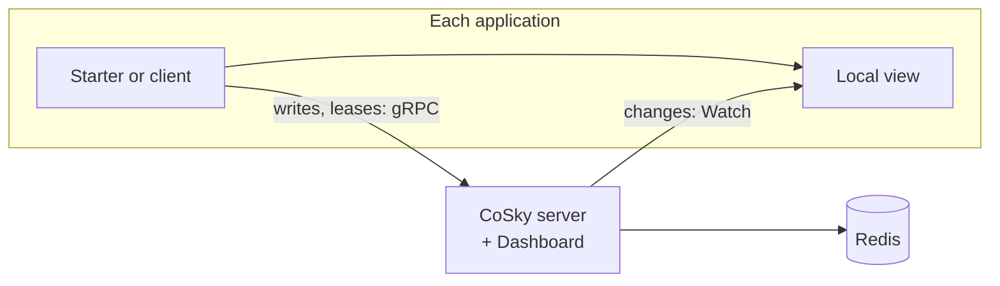

# Overview

CoSky provides **configuration management** and **service discovery** for microservices. A small server sits in front of **Redis**, and applications talk only to that server. Redis is the one piece of infrastructure it needs.

## How it works

- **Writes** go through the server, which applies each one atomically and gives the namespace a new revision.
- **Reads** come from a view in each application's memory, so they cost no network round trip.
- **Changes** reach every view over a Watch stream. A client that was away resumes from the revision it last saw.
- **Everything is a resource**: a Config, an Instance, a Namespace, a Role. They share one API, over gRPC and REST.

[Architecture](./architecture.md) explains the data model and the consistency guarantees.

## Features

| Area | What you get |
|---|---|
| Configuration | Spring Boot `spring.config.import` with live refresh; YAML, JSON, properties and text; revisions with rollback; zip import and export |
| Service discovery | Spring Cloud `DiscoveryClient`, `ServiceRegistry` and LoadBalancer; instances under a lease; metadata and weights; fixed instances |
| Resilience | Local views keep serving through an outage; a snapshot on disk survives a restart; mass expiry protection; several server replicas |
| Security | ServiceAccount tokens and OIDC on every call, data plane included; roles scoped to namespaces and name prefixes; TLS; a structured audit log |
| Operations | One image with the Dashboard; Kustomize manifests; Prometheus metrics; OpenTelemetry traces; topology of who watches whom |

## When CoSky fits

- You already run Redis, and would rather not add a consensus system to your stack.
- A namespace holds up to about 50,000 instances and 10,000 Configs, the size [measured](./performance.md).
- You want Spring Cloud integration, or Kotlin, or can generate a gRPC or REST client from its protos and OpenAPI document.

## When it does not

- Your data must survive any single failure without loss. Redis replication is asynchronous, so a failover can lose the last writes. CoSky notices and recovers, as [Architecture](./architecture.md) describes, but it cannot bring them back. Use a Raft-based system instead.
- You need health checks run by the server. Instances stay alive by renewing a lease, and CoSky does not probe them.
- You need a client for another language off the shelf. Only Kotlin has one; other languages use the protos.

## Where to go next

| Goal | Page |
|---|---|
| Run it in five minutes | [Getting Started](./getting-started.md) |
| Serve Spring properties | [Configuration](./configuration.md) |
| Register and find services | [Service Discovery](./service-discovery.md) |
| Use it without Spring | [Using the SDK](./sdk.md) |
| Run it in production | [Deployment](./deployment.md), [Security](./security.md) |
| Move from CoSky 6.x | [Moving from 6.x](./upgrade-8.md) |
| Look up a property or an endpoint | [Configuration Properties](./properties.md), [REST API](./rest-api.md) |
