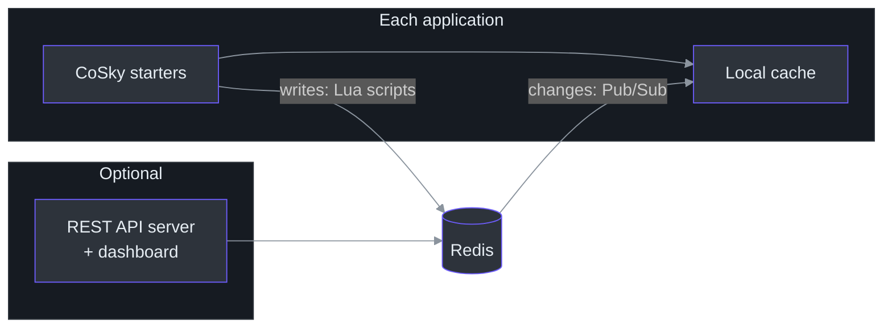

# Overview

CoSky provides **configuration management** and **service discovery** for Spring Cloud microservices, using only **Redis** as infrastructure. There is no registry cluster to run: applications talk to Redis directly through the CoSky starters, and an optional REST API server adds a web dashboard, users and permissions.

## How it works

- **Writes** (registering an instance, saving a config) are single Lua scripts, so they are atomic.
- **Reads** are served from a local cache in each application, so they cost no network round trip.
- **Changes** reach every cache through Redis Pub/Sub; a periodic resync covers messages lost while disconnected.

[Architecture](./architecture.md) explains the data model and the consistency guarantees in detail.

## Features

| Area | What you get |
|---|---|
| Configuration | Spring Cloud property source with live refresh, YAML / properties, versions with rollback, import and export (Nacos-compatible zip) |
| Service discovery | Spring Cloud `DiscoveryClient` and service registry, ephemeral instances with automatic expiry, metadata and status, weighted load balancing, service topology |
| Operations | REST API server with a web dashboard, JWT authentication, namespace-scoped roles, audit log, statistics |
| Isolation | Namespaces separate environments or tenants in one Redis |

## When CoSky fits

CoSky is a good fit when you already run Redis, use Spring Cloud, and want discovery and configuration without operating another cluster.

Consider an alternative when you need:

- **DNS-based discovery** or non-JVM clients without HTTP access to the REST API: CoSky clients are JVM libraries.
- **Health checks performed by the registry** (TCP/HTTP probes): CoSky instances prove liveness by renewing; a hung process that keeps renewing stays registered.
- **Strong consistency for reads**: application reads come from a local cache that is updated asynchronously (typically within milliseconds).

| | CoSky | Nacos | Consul | Eureka |
|---|---|---|---|---|
| Infrastructure | Redis | Nacos cluster + MySQL | Consul cluster | Eureka servers |
| Configuration | ✅ | ✅ | ✅ (KV) | ❌ |
| Discovery | ✅ | ✅ | ✅ | ✅ |
| Health check | Client renewal | Client beat, TCP/HTTP | TCP/HTTP/gRPC | Client beat |
| DNS interface | ❌ | ✅ | ✅ | ❌ |
| Spring Cloud | ✅ | ✅ | ✅ | ✅ |

## Where to go next

| I want to… | Read |
|---|---|
| Try CoSky in a Spring Boot app | [Getting Started](./getting-started.md) |
| Load and refresh configuration | [Configuration](./configuration.md) |
| Register and discover services | [Service Discovery](./service-discovery.md) |
| Use CoSky without Spring | [Using the SDK](./sdk.md) |
| Run the REST API server and dashboard | [Deployment](./deployment.md), [Security](./security.md), [Dashboard](./dashboard.md) |
| Upgrade from 5.x | [Upgrading to 6.0](./upgrade-6.md) |
| Look up a property or an endpoint | [Configuration Properties](./properties.md), [REST API](./rest-api.md) |
| Understand the design | [Architecture](./architecture.md), [Performance](./performance.md) |
| Contribute | [Internals](./internals.md) and [CONTRIBUTING.md](https://github.com/Ahoo-Wang/CoSky/blob/v6/CONTRIBUTING.md) |
