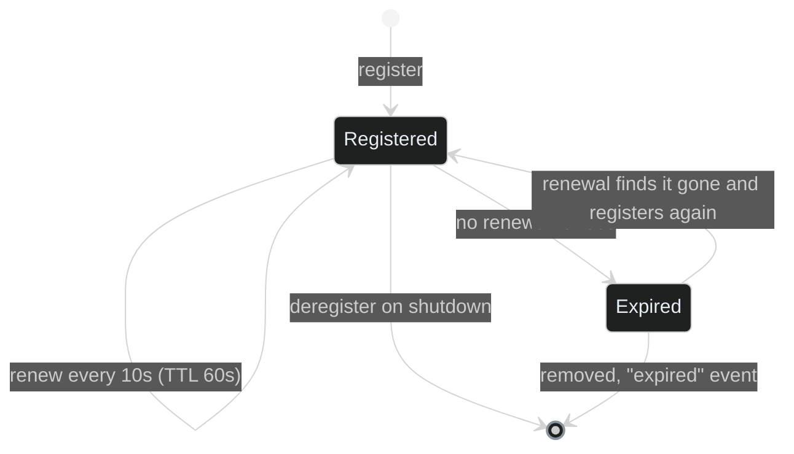

# Service Discovery

This guide is for application developers using the discovery starter. Setup is covered in [Getting Started](./getting-started.md).

## Registration

With the discovery starter on the classpath, an application registers itself once its web server has started, and deregisters on graceful shutdown. Its instance is described by:

| Field | Property (`spring.cloud.cosky.discovery.registry.*`) | Default |
|---|---|---|
| Service id | `service-id` | `spring.application.name` |
| Host | `host` | first non-loopback IP address |
| Port | `port` | the web server port |
| Scheme | `schema` | `http` |
| Weight | `weight` | `1` |
| Metadata | `metadata.<key>` | none |
| Status | `initial-status` | `UP` (stored as metadata `instance_status`) |

The instance id is `<serviceId>@<scheme>#<host>#<port>`, so an instance re-registering from the same address replaces itself.

`spring.cloud.service-registry.auto-registration.enabled=false` keeps an application discoverable-only: it discovers others without registering.

## Staying registered: ephemeral instances

By default an instance is **ephemeral**: it lives for a TTL and must keep renewing it.



- `renew.period` (10s) must stay well below `ttl` (60s), so that a few missed renewals do not expire a healthy instance.
- An expired instance is removed and announced by any registered CoSky client in the namespace; no server needs to run.
- If an instance expired anyway, for example during a network partition, its next renewal registers it again with the metadata set since it first registered.
- Consumers never receive an instance whose TTL has passed, even before it is removed.

**Fixed instances** (`is-ephemeral: false`) never expire and are not renewed. Use them for endpoints that cannot run the client, such as a database proxy registered through the [REST API](./rest-api.md); remove them explicitly.

Liveness is proven by renewing only: CoSky does not probe instances. A process that hangs but keeps its renewal thread alive stays registered; combine CoSky with health-aware routing or circuit breakers where that matters.

## Discovering services

Applications discover through Spring Cloud's standard APIs, backed by a local cache that change events keep current:

```kotlin
@Autowired lateinit var discoveryClient: DiscoveryClient          // or ReactiveDiscoveryClient

discoveryClient.services                                          // service ids in the namespace
discoveryClient.getInstances("order-service")                     // live instances
```

With `spring-cloud-starter-loadbalancer`, `@LoadBalanced` `WebClient` / `RestClient` and OpenFeign resolve `http://order-service/...` through CoSky.

Discovery is scoped to the application's namespace. Lookups are answered from memory; the first lookup of a service loads it from Redis and subscribes to its changes.

## Metadata and status

Metadata is a string map attached to an instance, e.g. a zone or a version. Set it at registration with `registry.metadata.*`, edit it in the dashboard, or at runtime through the [SDK](./sdk.md#service-discovery).

Spring Cloud's `ServiceRegistry.setStatus` (for example through the `/actuator/serviceregistry` endpoint) stores the status as the `instance_status` metadata.

Spring Cloud discovery returns only instances whose status is `UP`, or that have no status (such as fixed instances registered through the REST API). Setting an instance to `OUT_OF_SERVICE` therefore takes it out of rotation without deregistering it, and setting it back to `UP` returns it. Set `spring.cloud.cosky.discovery.filter-only-up-instances=false` to receive every instance.

## Load balancing and weights

| Client | Algorithm | Uses weights |
|---|---|---|
| Spring Cloud LoadBalancer (default) | Round robin | ❌ |
| Spring Cloud LoadBalancer with `spring.cloud.loadbalancer.configurations=weighted` | Weighted | ✅ |
| CoSky `LoadBalancer` bean (`BinaryWeightRandomLoadBalancer`) | Weighted random | ✅ |

CoSky exposes each instance's weight as the `weight` metadata of Spring Cloud instances, which is where Spring Cloud LoadBalancer's weighted configuration reads it. Code using the CoSky API directly can inject CoSky's `LoadBalancer` and call `choose(namespace, serviceId)`. The SDK also provides `RandomLoadBalancer` (ignores weights) and the `ArrayWeightRandomLoadBalancer` / `TreeWeightRandomLoadBalancer` variants, which choose by weight like the default with different memory and lookup trade-offs.

## Service topology

Each application records itself as a consumer of the services it discovers, and the dashboard draws the resulting dependency graph. Turn it off with `spring.cloud.cosky.discovery.topology-enabled=false`. A discovered service from another namespace appears as `<namespace>.<serviceId>`.

## See also

- [Configuration Properties](./properties.md#service-discovery) for every property.
- [Using the SDK](./sdk.md#service-discovery) to register and discover without Spring.
- [Architecture](./architecture.md#service-discovery) for the data model and expiry mechanics.
