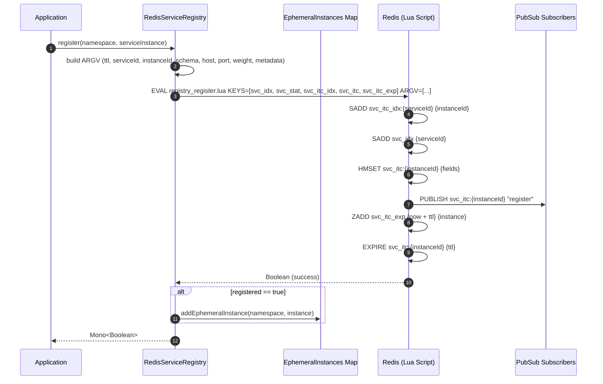
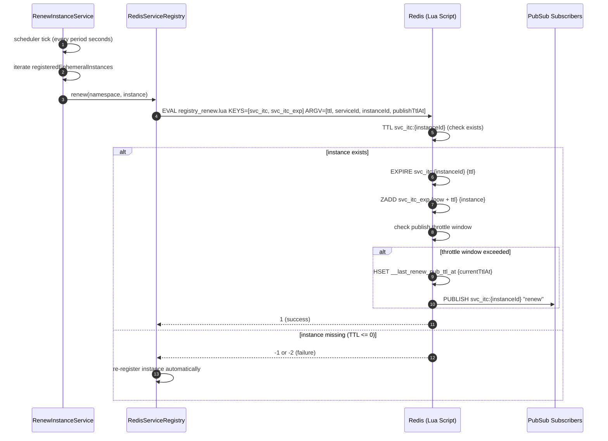
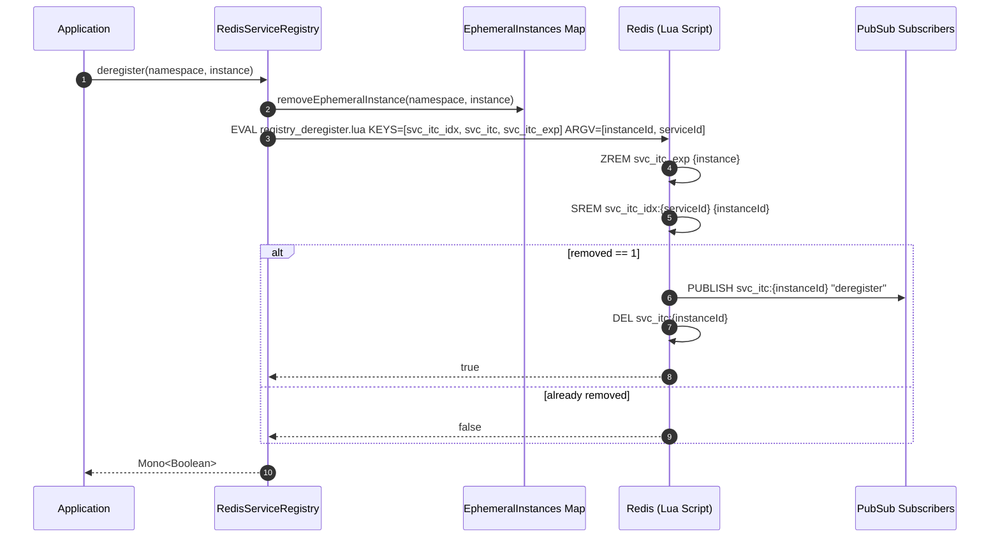
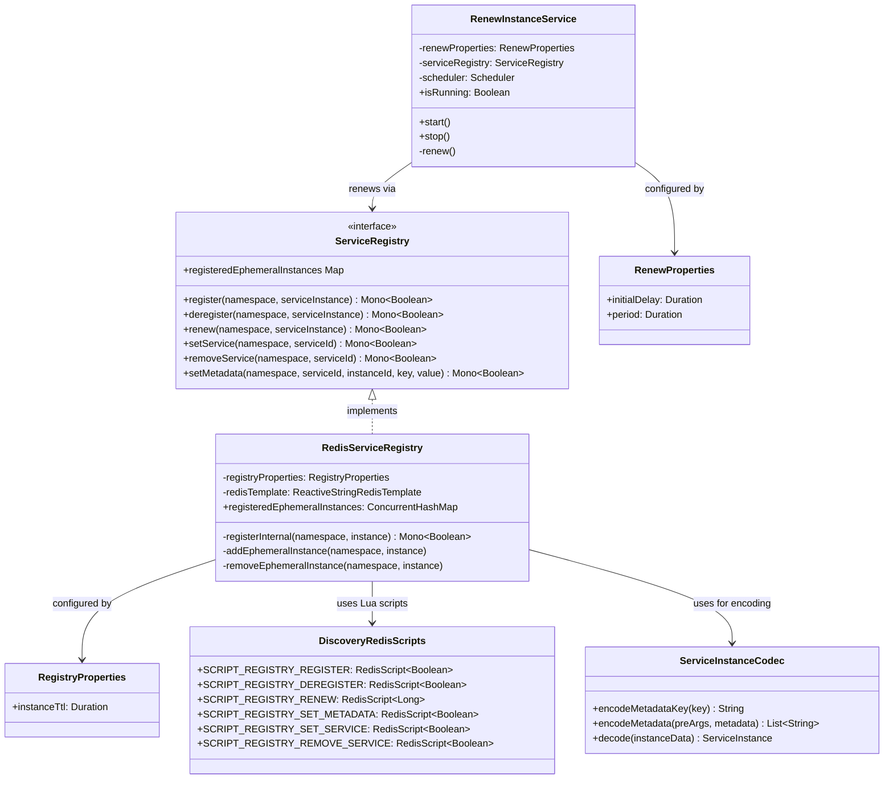

# Service Registry

CoSky's Service Registry manages the lifecycle of service instances within a microservice cluster. Backed by Redis and Lua scripts, it provides atomic, race-condition-free registration, deregistration, heartbeat renewal, and metadata management -- all operating within a multi-tenant namespace model.

| Aspect | Detail |
|---|---|
| **Interface** | `ServiceRegistry` |
| **Redis Implementation** | `RedisServiceRegistry` |
| **Storage Engine** | Redis Hash + Set + Lua scripts |
| **Concurrency Model** | Reactive (`Mono<Boolean>`) |
| **Heartbeat** | `RenewInstanceService` (scheduled keep-alive) |
| **Serialization** | `ServiceInstanceCodec` |

## ServiceRegistry Interface

The [`ServiceRegistry`](https://github.com/Ahoo-Wang/CoSky/blob/main/cosky-discovery/src/main/kotlin/me/ahoo/cosky/discovery/ServiceRegistry.kt) interface defines the contract for all registry operations.

| Method | Return Type | Description | Source |
|---|---|---|---|
| `register` | `Mono<Boolean>` | Registers a service instance with optional TTL | [ServiceRegistry.kt:32](https://github.com/Ahoo-Wang/CoSky/blob/main/cosky-discovery/src/main/kotlin/me/ahoo/cosky/discovery/ServiceRegistry.kt#L32) |
| `deregister` | `Mono<Boolean>` | Removes a service instance from the registry | [ServiceRegistry.kt:42](https://github.com/Ahoo-Wang/CoSky/blob/main/cosky-discovery/src/main/kotlin/me/ahoo/cosky/discovery/ServiceRegistry.kt#L42) |
| `renew` | `Mono<Boolean>` | Renews/extends the TTL of an ephemeral instance | [ServiceRegistry.kt:40](https://github.com/Ahoo-Wang/CoSky/blob/main/cosky-discovery/src/main/kotlin/me/ahoo/cosky/discovery/ServiceRegistry.kt#L40) |
| `setService` | `Mono<Boolean>` | Creates a named service entry in the namespace index | [ServiceRegistry.kt:23](https://github.com/Ahoo-Wang/CoSky/blob/main/cosky-discovery/src/main/kotlin/me/ahoo/cosky/discovery/ServiceRegistry.kt#L23) |
| `removeService` | `Mono<Boolean>` | Removes a named service from the namespace index | [ServiceRegistry.kt:23](https://github.com/Ahoo-Wang/CoSky/blob/main/cosky-discovery/src/main/kotlin/me/ahoo/cosky/discovery/ServiceRegistry.kt#L23) |
| `setMetadata` | `Mono<Boolean>` | `setMetadata(key, value)` sets one entry and keeps the others ([ServiceRegistry.kt:55](https://github.com/Ahoo-Wang/CoSky/blob/main/cosky-discovery/src/main/kotlin/me/ahoo/cosky/discovery/ServiceRegistry.kt#L55)); `setMetadata(map)` replaces all metadata ([ServiceRegistry.kt:66](https://github.com/Ahoo-Wang/CoSky/blob/main/cosky-discovery/src/main/kotlin/me/ahoo/cosky/discovery/ServiceRegistry.kt#L66)) |
| `reapExpiredInstances` | `Mono<Long>` | Removes instances whose TTL has passed and publishes their `expired` events | [ServiceRegistry.kt:78](https://github.com/Ahoo-Wang/CoSky/blob/main/cosky-discovery/src/main/kotlin/me/ahoo/cosky/discovery/ServiceRegistry.kt#L78) |

## ServiceInstance Data Model

A [`ServiceInstance`](https://github.com/Ahoo-Wang/CoSky/blob/main/cosky-discovery/src/main/kotlin/me/ahoo/cosky/discovery/ServiceInstance.kt) extends the base [`Instance`](https://github.com/Ahoo-Wang/CoSky/blob/main/cosky-discovery/src/main/kotlin/me/ahoo/cosky/discovery/Instance.kt) interface and carries the following fields:

| Field | Type | Default | Description |
|---|---|---|---|
| `instanceId` | `String` | -- | Unique identifier: `{serviceId}@{schema}#{host}#{port}` |
| `serviceId` | `String` | -- | Logical service name |
| `schema` | `String` | -- | Protocol schema (`http`, `https`, etc.) |
| `host` | `String` | -- | Host address |
| `port` | `Int` | -- | Port number |
| `weight` | `Int` | `1` | Load balancer weight |
| `isEphemeral` | `Boolean` | `true` | Ephemeral instances expire; persistent instances do not |
| `ttlAt` | `Long` | `TTL_AT_FOREVER (-1)` | Absolute TTL expiry timestamp (epoch seconds) |
| `metadata` | `Map<String, String>` | `emptyMap()` | User-defined key-value metadata; keys beginning with `_` are rejected |

The `isExpired` property on `ServiceInstance` compares `ttlAt` against the current system time to determine whether an ephemeral instance has expired ([ServiceInstance.kt:34](https://github.com/Ahoo-Wang/CoSky/blob/main/cosky-discovery/src/main/kotlin/me/ahoo/cosky/discovery/ServiceInstance.kt#L34)).

### ServiceInstanceCodec Serialization

[`ServiceInstanceCodec`](https://github.com/Ahoo-Wang/CoSky/blob/main/cosky-discovery/src/main/kotlin/me/ahoo/cosky/discovery/ServiceInstanceCodec.kt) handles encoding and decoding of instance data to/from Redis hash fields. It uses a `_` prefix for metadata keys and reserves `__` for system metadata:

```kotlin
// Encoding: metadata key "version" becomes "_version" in Redis
fun encodeMetadataKey(key: String): String {
    require(!key.startsWith(METADATA_PREFIX))
    return METADATA_PREFIX + key
}
```

Metadata keys must not begin with `_`. That prefix is reserved for internal fields such as `__last_renew_pub_ttl_at`; rejecting it prevents user metadata from colliding with registry state.

The `decode` function ([ServiceInstanceCodec.kt:57](https://github.com/Ahoo-Wang/CoSky/blob/main/cosky-discovery/src/main/kotlin/me/ahoo/cosky/discovery/ServiceInstanceCodec.kt#L57)) parses the flat key-value list returned by Redis `HGETALL` into a `ServiceInstance` object.

## Redis Implementation

### RedisServiceRegistry

[`RedisServiceRegistry`](https://github.com/Ahoo-Wang/CoSky/blob/main/cosky-discovery/src/main/kotlin/me/ahoo/cosky/discovery/redis/RedisServiceRegistry.kt) is the Redis-backed implementation of `ServiceRegistry`. It uses Lua scripts for atomic operations and maintains an in-memory map of registered ephemeral instances:

```kotlin
class RedisServiceRegistry(
    private val registryProperties: RegistryProperties,
    private val redisTemplate: ReactiveStringRedisTemplate
) : ServiceRegistry
```

Key design points:
- Ephemeral instances are tracked in a `ConcurrentHashMap<NamespacedInstanceId, ServiceInstance>` for heartbeat renewal ([RedisServiceRegistry.kt:47](https://github.com/Ahoo-Wang/CoSky/blob/main/cosky-discovery/src/main/kotlin/me/ahoo/cosky/discovery/redis/RedisServiceRegistry.kt#L47)).
- The `register` method adds to the ephemeral map only after the Lua script succeeds -- inside `doOnNext`, and only when the script returned `true` ([RedisServiceRegistry.kt:110](https://github.com/Ahoo-Wang/CoSky/blob/main/cosky-discovery/src/main/kotlin/me/ahoo/cosky/discovery/redis/RedisServiceRegistry.kt#L110)).
- If a renew fails (instance key missing), it automatically re-registers the instance ([RedisServiceRegistry.kt:203](https://github.com/Ahoo-Wang/CoSky/blob/main/cosky-discovery/src/main/kotlin/me/ahoo/cosky/discovery/redis/RedisServiceRegistry.kt#L203)).

### DiscoveryRedisScripts

[`DiscoveryRedisScripts`](https://github.com/Ahoo-Wang/CoSky/blob/main/cosky-discovery/src/main/kotlin/me/ahoo/cosky/discovery/redis/DiscoveryRedisScripts.kt) loads all registry-related Lua scripts from the classpath through `LuaScripts`, which resolves `-- @include` directives so the scripts share `cosky/discovery/discovery_lib.lua`. Every key known at call time is generated by `DiscoveryKeyGenerator` and passed via `KEYS`; keys only known inside the script use the shared Lua key functions, which `DiscoveryLuaKeysTest` keeps identical to the Kotlin generator:

| Script | Resource File | Purpose |
|---|---|---|
| `SCRIPT_REGISTRY_REGISTER` | `registry_register.lua` | Atomic instance registration |
| `SCRIPT_REGISTRY_DEREGISTER` | `registry_deregister.lua` | Atomic instance removal |
| `SCRIPT_REGISTRY_RENEW` | `registry_renew.lua` | TTL renewal with publish throttling |
| `SCRIPT_REGISTRY_SET_METADATA` | `registry_set_metadata.lua` | Replace all instance metadata |
| `SCRIPT_REGISTRY_PUT_METADATA` | `registry_put_metadata.lua` | Set metadata entries, keeping the others |
| `SCRIPT_REGISTRY_REAP` | `registry_reap.lua` | Reap expired instances through the expiry index |
| `SCRIPT_REGISTRY_SET_SERVICE` | `registry_set_service.lua` | Create service in namespace index |
| `SCRIPT_REGISTRY_REMOVE_SERVICE` | `registry_remove_service.lua` | Remove service from namespace index |

### RegistryProperties

[`RegistryProperties`](https://github.com/Ahoo-Wang/CoSky/blob/main/cosky-discovery/src/main/kotlin/me/ahoo/cosky/discovery/RegistryProperties.kt) configures the default instance TTL:

| Property | Type | Default | Description |
|---|---|---|---|
| `instanceTtl` | `Duration` | `1 minute` | Time-to-live for ephemeral instances |

## RenewInstanceService (Heartbeat)

[`RenewInstanceService`](https://github.com/Ahoo-Wang/CoSky/blob/main/cosky-discovery/src/main/kotlin/me/ahoo/cosky/discovery/RenewInstanceService.kt) provides the keep-alive mechanism for ephemeral instances. It periodically renews all registered ephemeral instances on a caller-owned scheduler (`Schedulers.parallel()` by default):

| Property | Default | Description |
|---|---|---|
| `initialDelay` | `1 second` | Delay before first renewal cycle |
| `period` | `10 seconds` | Interval between renewal cycles |

The renewal period must be less than `RegistryProperties.instanceTtl` to prevent premature expiration. The service iterates all `registeredEphemeralInstances` and calls `renew` on each one via the `ServiceRegistry` ([RenewInstanceService.kt:117](https://github.com/Ahoo-Wang/CoSky/blob/main/cosky-discovery/src/main/kotlin/me/ahoo/cosky/discovery/RenewInstanceService.kt#L117)):

- each renew is bounded by `period` and its failure is logged without affecting the other instances;
- a renewal round still in flight makes the next tick be skipped instead of overlapping;
- `stop()` only cancels the schedule, so the service can be started again.

## Sequence Diagrams

### Register Flow



<!-- Sources: cosky-discovery/src/main/resources/registry_register.lua, cosky-discovery/src/main/kotlin/me/ahoo/cosky/discovery/redis/RedisServiceRegistry.kt:105, cosky-discovery/src/main/kotlin/me/ahoo/cosky/discovery/redis/DiscoveryRedisScripts.kt:26 -->

### Renew / Heartbeat Flow



<!-- Sources: cosky-discovery/src/main/resources/registry_renew.lua, cosky-discovery/src/main/kotlin/me/ahoo/cosky/discovery/RenewInstanceService.kt:117, cosky-discovery/src/main/kotlin/me/ahoo/cosky/discovery/redis/RedisServiceRegistry.kt:177 -->

### Deregister Flow



<!-- Sources: cosky-discovery/src/main/resources/registry_deregister.lua, cosky-discovery/src/main/kotlin/me/ahoo/cosky/discovery/redis/RedisServiceRegistry.kt:210, cosky-discovery/src/main/kotlin/me/ahoo/cosky/discovery/redis/DiscoveryRedisScripts.kt:26 -->

## Expiry Reaping

An ephemeral instance expires when its key's TTL runs out. Removing it from its service index and publishing the `expired` event is the job of the **expiry reaper**:

- `register` and `renew` add the instance to the namespace's expiry index `{namespace}:svc_itc_exp`, scored by its `ttlAt`; `deregister` and fixed registrations remove it.
- `registry_reap.lua` takes the due candidates (`ZRANGEBYSCORE -inf now LIMIT 0 100`) in `O(log N + k)`. A candidate whose key is gone is removed from its index and announced as `expired`; a candidate whose key is still alive is re-scored. The index only lists candidates — the key's TTL stays authoritative, so a stale index can never drop a live instance ([RedisServiceRegistry.kt:249](https://github.com/Ahoo-Wang/CoSky/blob/main/cosky-discovery/src/main/kotlin/me/ahoo/cosky/discovery/redis/RedisServiceRegistry.kt#L249)).
- `RenewInstanceService` reaps the namespaces it renews after every renewal round, so every registered client keeps its namespaces clean and `expired` events no longer depend on `cosky-rest-api` ([RenewInstanceService.kt:99](https://github.com/Ahoo-Wang/CoSky/blob/main/cosky-discovery/src/main/kotlin/me/ahoo/cosky/discovery/RenewInstanceService.kt#L99)).

Reads (`discovery_get_instances.lua`) and the statistics job still remove dead instances lazily, which also covers instances registered by older clients that do not maintain the index.

### Renew Events Carrying ttlAt

Renew events can carry the new `ttlAt` (`renew:<ttlAt>`), so that consumers update their cached instance without a Redis round trip. Parsing accepts the payload ([InstanceChangedEvent.kt:50](https://github.com/Ahoo-Wang/CoSky/blob/main/cosky-discovery/src/main/kotlin/me/ahoo/cosky/discovery/InstanceChangedEvent.kt#L50)); publishing it is off by default (`spring.cloud.cosky.discovery.registry.renew-event-carries-ttl-at`, [RegistryProperties.kt:32](https://github.com/Ahoo-Wang/CoSky/blob/main/cosky-discovery/src/main/kotlin/me/ahoo/cosky/discovery/RegistryProperties.kt#L32)). Enable it only once every client runs a version that parses it: older clients reject the payload.

## Redis Key Structure

The registry uses a structured key pattern for organizing service and instance data within each namespace:

| Redis Key | Type | Purpose | Example |
|---|---|---|---|
| `{namespace}:svc_idx` | SET | Set of all service IDs in the namespace | `production:svc_idx` |
| `{namespace}:svc_stat` | HASH | Service ID to instance count statistics | `production:svc_stat` |
| `{namespace}:svc_itc_idx:{serviceId}` | SET | Set of instance IDs for a given service | `production:svc_itc_idx:order-service` |
| `{namespace}:svc_itc:{instanceId}` | HASH | Instance data (fields: instanceId, serviceId, schema, host, port, weight, ephemeral, metadata) | `production:svc_itc:order-service@http#10.0.1.5#8080` |
| `{namespace}:svc_itc_exp` | ZSET | Expiry index: ephemeral instances scored by `ttlAt`, the candidates of reaping | `production:svc_itc_exp` |
| `{namespace}:topology_idx` | HASH | Topology index: consumer name to timestamp | `production:topology_idx` |
| `{namespace}:topology:{consumer}` | HASH | Topology deps: producer name to timestamp | `production:topology:gateway-service` |

Note: `ttl_at` is **not** stored in the instance hash. It is computed at read time as `now + ttl` by the discovery scripts ([discovery_lib.lua:50](https://github.com/Ahoo-Wang/CoSky/blob/main/cosky-discovery/src/main/resources/cosky/discovery/discovery_lib.lua#L50)). The renew script may additionally write the system field `__last_renew_pub_ttl_at` into the hash for publish throttling ([registry_renew.lua:20](https://github.com/Ahoo-Wang/CoSky/blob/main/cosky-discovery/src/main/resources/registry_renew.lua#L20)).

The instance ID format is `{serviceId}@{schema}#{host}#{port}` (e.g., `order-service@http#10.0.1.5#8080`), as defined in [`Instance.asInstanceId`](https://github.com/Ahoo-Wang/CoSky/blob/main/cosky-discovery/src/main/kotlin/me/ahoo/cosky/discovery/Instance.kt#L57).

## Class Diagram



<!-- Sources: cosky-discovery/src/main/kotlin/me/ahoo/cosky/discovery/ServiceRegistry.kt:22, cosky-discovery/src/main/kotlin/me/ahoo/cosky/discovery/redis/RedisServiceRegistry.kt:39, cosky-discovery/src/main/kotlin/me/ahoo/cosky/discovery/RegistryProperties.kt:22, cosky-discovery/src/main/kotlin/me/ahoo/cosky/discovery/RenewInstanceService.kt:39, cosky-discovery/src/main/kotlin/me/ahoo/cosky/discovery/RenewProperties.kt:22, cosky-discovery/src/main/kotlin/me/ahoo/cosky/discovery/redis/DiscoveryRedisScripts.kt:23 -->

## Related Pages

- [Service Discovery](./service-discovery) -- How clients discover registered instances
- [Load Balancers](./load-balancers) -- How instances are selected from the registry
- [Service Topology](./service-topology) -- How service dependency graphs are built

## References

- [ServiceRegistry.kt](https://github.com/Ahoo-Wang/CoSky/blob/main/cosky-discovery/src/main/kotlin/me/ahoo/cosky/discovery/ServiceRegistry.kt)
- [ServiceInstance.kt](https://github.com/Ahoo-Wang/CoSky/blob/main/cosky-discovery/src/main/kotlin/me/ahoo/cosky/discovery/ServiceInstance.kt)
- [ServiceInstanceCodec.kt](https://github.com/Ahoo-Wang/CoSky/blob/main/cosky-discovery/src/main/kotlin/me/ahoo/cosky/discovery/ServiceInstanceCodec.kt)
- [Instance.kt](https://github.com/Ahoo-Wang/CoSky/blob/main/cosky-discovery/src/main/kotlin/me/ahoo/cosky/discovery/Instance.kt)
- [RedisServiceRegistry.kt](https://github.com/Ahoo-Wang/CoSky/blob/main/cosky-discovery/src/main/kotlin/me/ahoo/cosky/discovery/redis/RedisServiceRegistry.kt)
- [DiscoveryRedisScripts.kt](https://github.com/Ahoo-Wang/CoSky/blob/main/cosky-discovery/src/main/kotlin/me/ahoo/cosky/discovery/redis/DiscoveryRedisScripts.kt)
- [RegistryProperties.kt](https://github.com/Ahoo-Wang/CoSky/blob/main/cosky-discovery/src/main/kotlin/me/ahoo/cosky/discovery/RegistryProperties.kt)
- [RenewInstanceService.kt](https://github.com/Ahoo-Wang/CoSky/blob/main/cosky-discovery/src/main/kotlin/me/ahoo/cosky/discovery/RenewInstanceService.kt)
- [RenewProperties.kt](https://github.com/Ahoo-Wang/CoSky/blob/main/cosky-discovery/src/main/kotlin/me/ahoo/cosky/discovery/RenewProperties.kt)
- [DiscoveryKeyGenerator.kt](https://github.com/Ahoo-Wang/CoSky/blob/main/cosky-discovery/src/main/kotlin/me/ahoo/cosky/discovery/DiscoveryKeyGenerator.kt)
- [registry_register.lua](https://github.com/Ahoo-Wang/CoSky/blob/main/cosky-discovery/src/main/resources/registry_register.lua)
- [registry_renew.lua](https://github.com/Ahoo-Wang/CoSky/blob/main/cosky-discovery/src/main/resources/registry_renew.lua)
- [registry_deregister.lua](https://github.com/Ahoo-Wang/CoSky/blob/main/cosky-discovery/src/main/resources/registry_deregister.lua)
