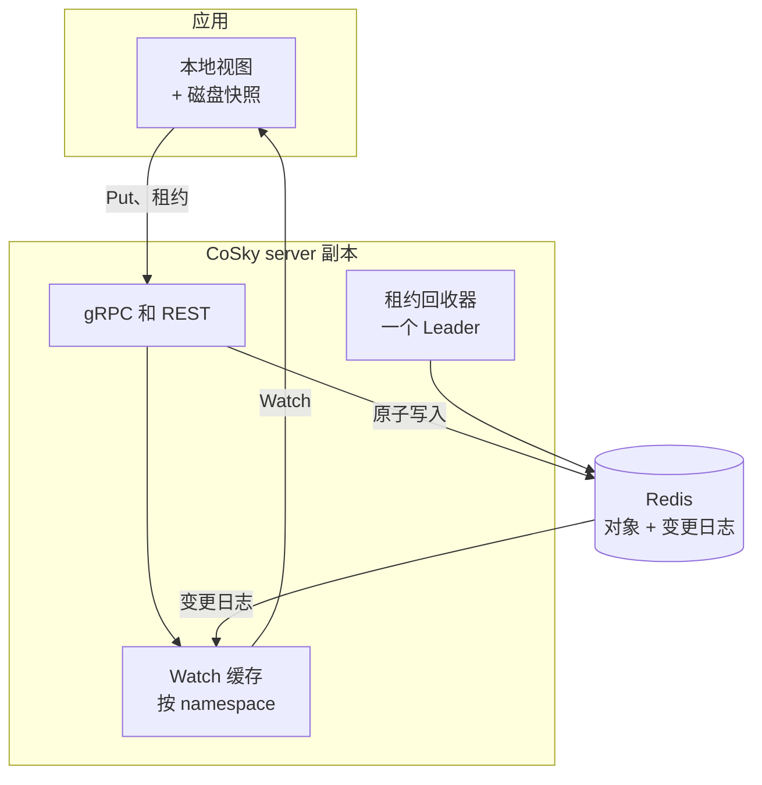

# 架构

本页说明 CoSky 如何工作、保证什么。每个决定背后的理由见[设计文档](https://github.com/Ahoo-Wang/CoSky/blob/main/docs/architecture-redesign.md)。

## 数据模型

一切都是 **Resource**：共享的元数据加一个 spec。Namespace、Config、Instance、ServiceAccount、Role 和 RoleBinding 都由同一套 API 处理。

**namespace** 是一切的单位：隔离、排序和存放都以它为单位，因为它位于一个 Redis slot 中。每个 namespace 有自己的 **revision**，每次写入加一。对象记录最后一次修改它的 revision。

全局类型位于保留的 namespace `_system`。

## 一次写入

1. server 校验请求并检查权限。
2. 一个 Lua 脚本原子地完成：按要求比较期望的 revision，给 namespace 分配下一个 revision，保存对象，并把变化追加到 namespace 的日志（一个 Redis Stream）。
3. 确认写入。

写入已有的内容不会有任何变化，也不产生 revision。

## 跟随变化

每个副本跟随每个 namespace 的日志，在内存中保存该 namespace 的不可变视图，以及最近变化的窗口。写入会发布一个提示，所以跟随者通常立即读取；提示丢失时，每个 namespace 也每秒轮询一次。

Watcher 不加锁地读取这些视图。慢的 watcher 只是错过中间的视图，之后从窗口中补齐，不会拖慢任何其他 watcher。如果掉出窗口，它会收到 `gone`，并从所 watch 内容的快照重新开始，代价仅此而已。

所以 Redis 的负载随 namespace 和副本的数量增长，而不是随客户端的数量增长。

每 5 分钟，副本还会把视图与存储比较一次。不一致本不该发生，所以按时间线丢失处理，见下文。

## 客户端可以依赖什么

- **顺序**：一个 namespace 内的变化按 revision 顺序到达，一个 revision 整体到达。订阅者不会看到半个 revision。
- **投递**：一条流内恰好一次。跨重连至少一次，客户端丢弃已应用的部分。
- **续传**：重连到任何副本的客户端都从看到的 revision 继续。
- **读取**来自本地视图，可能稍有滞后。传播延迟[测得](./performance.md)在 5,000 个连接时低于 200 毫秒。
- **写入**发往主节点，且是原子的。`minRevision` 让 REST 调用方可以从任何副本读到自己的写入。

作为安全网，客户端还会每 30 分钟左右从新的快照重新开始一次。

## 租约

一个进程在一个 namespace 中持有一个租约，并把实例挂在上面，所以无论有多少实例，续约成本都相同。不挂租约的 Instance 就是永久的，没有特殊处理。

同一时间由一个副本运行**回收器**，靠 Redis 中的锁选出。它移除到期租约的实例，并带有以下保护，因为错删活着的实例比保留死掉的实例更糟：

1. **宽限**：成为 Leader 或访问存储失败后，30 秒内不回收。客户端有时间重连；到期的租约在被回收之前仍可续约。
2. **延迟**：租约到期后再过 TTL 的三分之一才回收。同一次分区切断的租约是陆续到期的，因为它们续约的时刻不同。如果立即回收，它们会被逐个移除，下一步就永远看不到它们一起到期。
3. **大面积到期**：一个 namespace 超过一半的租约到期，且租约不少于 10 个时，暂停回收并记录错误日志。这覆盖了宽限检测不到的情况，比如客户端和 server 之间的分区。比例回落后重新开始宽限。5 分钟后无论如何都恢复回收。
4. **节奏**：每个 namespace 每轮最多 100 个租约。

代价是真正崩溃的进程默认还会列出 40 秒。调用方应该重试。

## Redis 丢失写入时

Redis 复制是异步的，所以故障切换可能丢失最近的写入，revision 随之回退或分叉。每个 namespace 带有一个 **epoch**，是发现这种情况时会变化的随机值，位置由 epoch 和 revision 共同组成。

| 由什么发现 | 然后 |
|---|---|
| 日志位置回退或缺失 | 每个副本重新加载，每个 watcher 收到 `gone` 并重新开始 |
| 客户端从存储中没有的 revision 续传 | 该客户端收到 `gone` |
| 租约已不存在 | 客户端重新注册全部实例 |
| 与存储的定期比较 | 替换 epoch，随后发生以上全部 |

系统会回到一致的状态，但 Redis 丢失的内容不会回来。恢复 Config 需要应用方从历史中找回或重新写入。

## server 不可用时

应用继续提供本地视图。重启时从磁盘加载[快照](./sdk.md#快照)。既没有快照也没有 server 时，非 `optional` 的导入会让启动失败，这样应用就不会在没有配置的情况下运行。

## 为什么要有 server

CoSky 6.x 让应用直连 Redis，结果数据面没有认证，每个客户端都绑定在一种存储布局上，Redis 的连接数还随进程数增长。增加一个小型 server 后，每次调用都有认证，任何语言都可以写客户端，流也能续传，而读取仍然在本地。server 自己不持久保存任何东西，所以副本可以随时增减。

保留 Redis，是因为这正是 CoSky 的定位：对已经在运行它的人来说，没有新东西要运维。需要更高持久性的人应该使用基于共识的系统。
