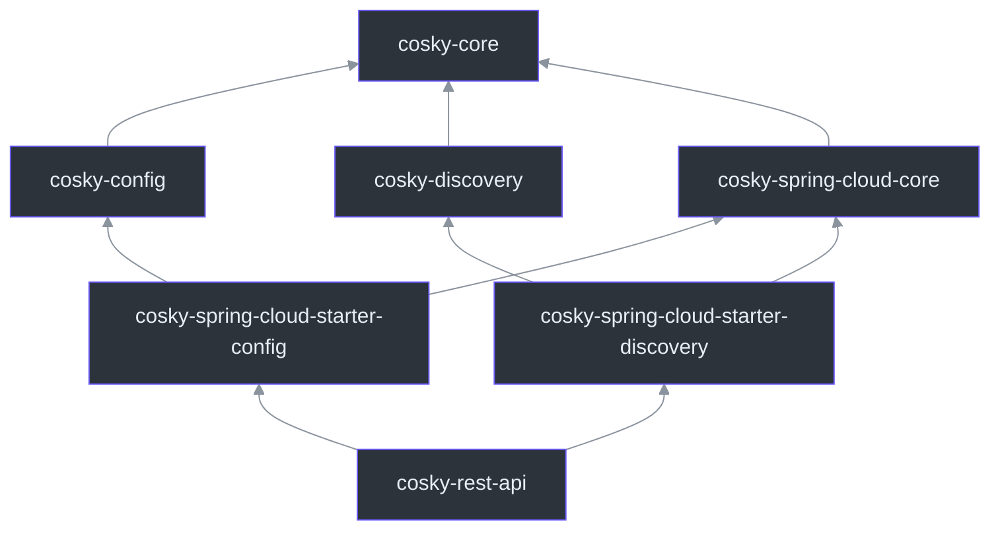
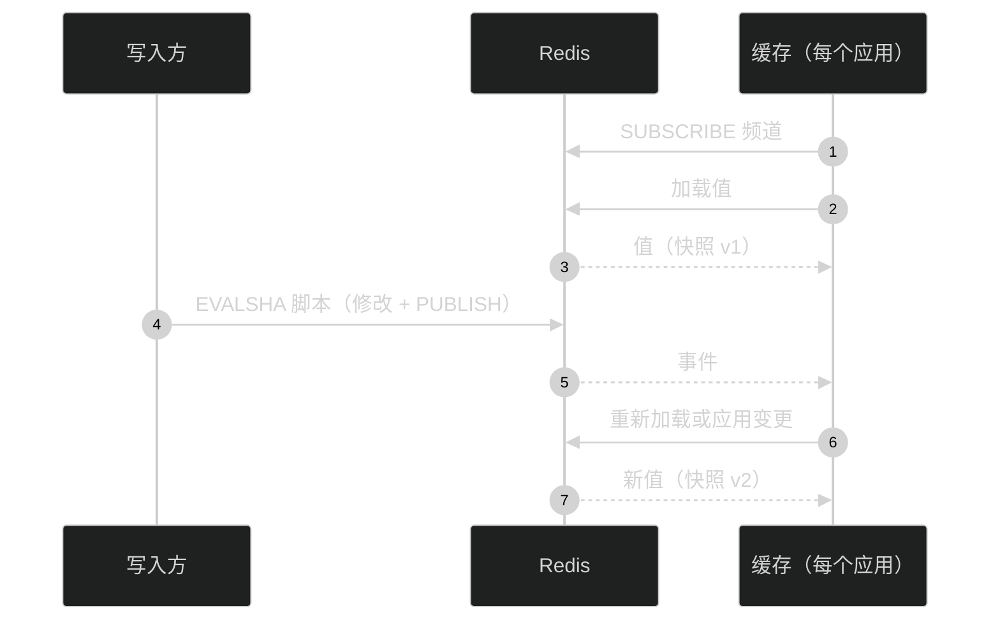

# 架构

本页说明 CoSky 如何工作，面向评估它、大规模运维它或参与贡献的工程师。

## 原则

1. **Redis 是唯一的基础设施。** 客户端直接访问 Redis；应用的读写路径上没有任何 CoSky 服务器。
2. **每次修改都是一个 Lua 脚本**，并发写入方不会看到中间状态，每次修改都会在一个 Pub/Sub 频道上发出通知。
3. **应用从内存读取。** 本地缓存跟随变更事件，读取不产生网络往返，Redis 负载也不随读流量增长。

## 模块

| 模块 | 职责 |
|---|---|
| `cosky-core` | 命名空间、Redis 键工具、Lua 脚本加载器、事件监听容器，以及其他一切所依赖的一致性缓存 `ReactiveWatchCache` |
| `cosky-config` | 配置存储、版本与回滚（`RedisConfigService`），及其缓存视图（`RedisConsistencyConfigService`） |
| `cosky-discovery` | 注册、续约与过期，服务发现及其缓存视图，负载均衡器，统计，拓扑 |
| `cosky-spring-cloud-*` | Spring Boot 自动配置、Spring Cloud 属性源、`DiscoveryClient` 与服务注册 |
| `cosky-rest-api` | REST API 服务器和控制台宿主：CoSec 安全、审计日志、统计任务 |

## 数据模型

每个键都以命名空间开头。命名空间被包进 Redis Cluster hash tag（`{dev}`），因此一个命名空间的所有键映射到同一个槽，一个 Lua 脚本可以同时操作其中多个键。

| 键 | 类型 | 内容 |
|---|---|---|
| `{ns}:cfg:{configId}` | hash | 当前配置：`data`、`hash`、`version`、`createTime` |
| `{ns}:cfg_idx` | set | 配置 ID |
| `{ns}:cfg_htr:{configId}:{version}` | hash | 历史版本，以及替换它的操作 |
| `{ns}:cfg_htr_idx:{configId}` | sorted set | 按版本排列的历史键；保留最近 10 个 |
| `{ns}:svc_idx` | set | 服务 ID |
| `{ns}:svc_itc_idx:{serviceId}` | set | 服务的实例 ID |
| `{ns}:svc_itc:{instanceId}` | hash | 实例字段与元数据；临时实例靠 Redis TTL 过期 |
| `{ns}:svc_itc_exp` | sorted set | 按过期时间排列的临时实例，用来查找过期实例而无需扫描 |
| `{ns}:svc_stat` | hash | 每个服务的实例数 |
| `{ns}:topology_idx`、`{ns}:topology:{consumer}` | set | 消费者，以及每个消费者使用的服务 |
| `cosky-{system}:ns_idx` | set | 控制台中列出的命名空间 |
| `cosky-{system}:…` | | REST API 服务器的用户、角色、登录锁定与审计日志 |

实例 ID 为 `<serviceId>@<scheme>#<host>#<port>`。实例元数据的键以 `_` 前缀存储；`__` 标记内部字段。

## 写入与事件

每次修改作为一个 Lua 脚本执行，并在以被修改的键命名的频道上发布消息：

| 频道 | 消息 |
|---|---|
| `{ns}:cfg:{configId}` | `set`、`remove`、`rollback` |
| `{ns}:svc_idx` | `set`、`remove`（服务出现或消失） |
| `{ns}:svc_itc:{instanceId}` | `register`、`deregister`、`expired`、`set_metadata`、`renew`（或 `renew:<ttlAt>`） |
| `cosky-{system}:role_resource_bind:{role}` | `save`、`remove` |

脚本通过加载时解析的 `-- @include` 指令共享函数，并通过 `KEYS` 接收它们操作的键，因此在 Redis Cluster 上无需改动，也不需要 Redis Functions 或模块。

## 一致性模型

每个缓存视图（配置、服务、实例、安全策略、角色）都是一个 `ReactiveWatchCache`。对每个键，它：

1. **订阅**该键的频道，并等待订阅生效；
2. 从 Redis **加载**值，这样中间不会漏掉任何变更；
3. 按顺序逐个**应用**事件，只有值真正变化时才发布新的不可变快照。

保证与限制：

- **读取最终一致**，通常在写入后毫秒内更新。写入在 Redis 中立即可见，缓存随后跟上。
- **丢失的消息会被修复。** Pub/Sub 最多投递一次；每个缓存的键还会每 5 分钟重新加载一次，限定了漏掉消息后的陈旧时间。
- **失败不会被缓存。** 加载失败会退避重试（1 秒到 30 秒）。期间继续提供最近一次的有效快照；只有从未加载成功的键才会让读取方失败。
- **快照被共享。** 每次变更只构建一次快照，未变化的值就是同一个对象，因此读取方可以缓存由它派生的数据；负载均衡器就是这样复用自身状态的。
- **缓存的键会一直保留。** 一个键一旦被读取，在缓存的生命周期内一直保持订阅。

## 服务发现

**过期。** 临时实例的 hash 带有 Redis TTL，由客户端续约（默认每 10 秒续约一次，TTL 60 秒）。Redis 删除它时不会发出任何通知，所以每次续约还会把过期时间记录到 `{ns}:svc_itc_exp`。每轮续约之后，每个客户端会清理其命名空间中最多 100 个已过期的实例：如果键确实已经不存在，就把实例从服务中移除并发布 `expired`。读取时也会顺带做同样的清理。实例的消失不需要任何服务器。

**续约事件会被节流。** 只有在上一次发布的过期时间即将到达时才发布续约事件，因此稳定运行的实例群产生的事件很少。默认情况下消费者随后会重新读取实例的 TTL；开启 `renew-event-carries-ttl-at` 后，事件直接携带新的过期时间（所有客户端都运行 6.0 后再开启）。

**读取时过滤过期实例**：用本地时钟比较其过期时间，所以消费者不依赖清理的延迟。请保持时钟同步（NTP）：时钟偏快的客户端可能把存活实例当作已过期。

## REST API 服务器

服务器是一个 Spring Boot 应用，使用与普通应用相同的 starter，此外还有：

- **CoSec**：JWT 认证与基于策略的授权（[安全](./security.md)）；
- **Simba**：通过 Redis 选出唯一一个实例，每 10 秒刷新服务统计；
- **CosId**：分布式 ID 生成。

它自身不保存状态，可以随意增减实例。

## 取舍

| 决策 | 收益 | 代价 |
|---|---|---|
| Redis 作为唯一存储 | 无需运维新组件；Redis 快且熟悉 | Redis 的可用性与持久化就是 CoSky 的；Redis 故障时写入停止（缓存读取继续） |
| 客户端续约而非服务端健康检查 | 不需要服务器；随客户端扩展 | 进程卡死但仍在续约时会保持注册 |
| 由 Pub/Sub 驱动的本地缓存 | 纳秒级读取，Redis 负载与读流量无关 | 最终一致；每个被监听的键占用一个订阅 |
| 每次修改都用 Lua 脚本 | 无需分布式锁即可保证原子性 | 脚本是数据契约的一部分，跨客户端版本修改需谨慎 |
| 命名空间 hash tag | 多键脚本在集群上安全 | 一个命名空间不能分布到多个集群槽 |
