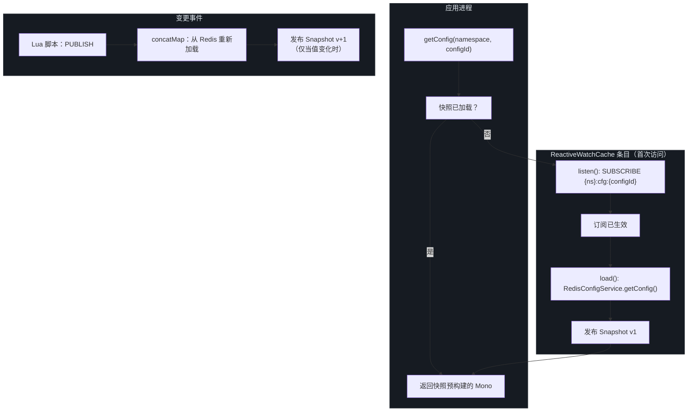
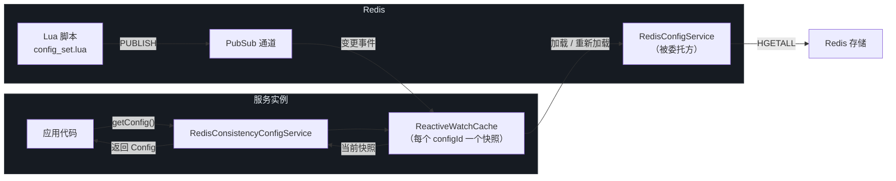
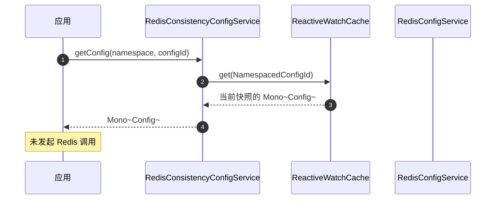
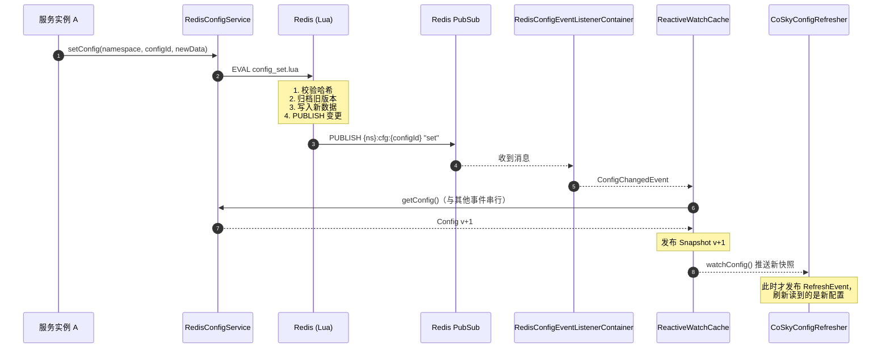
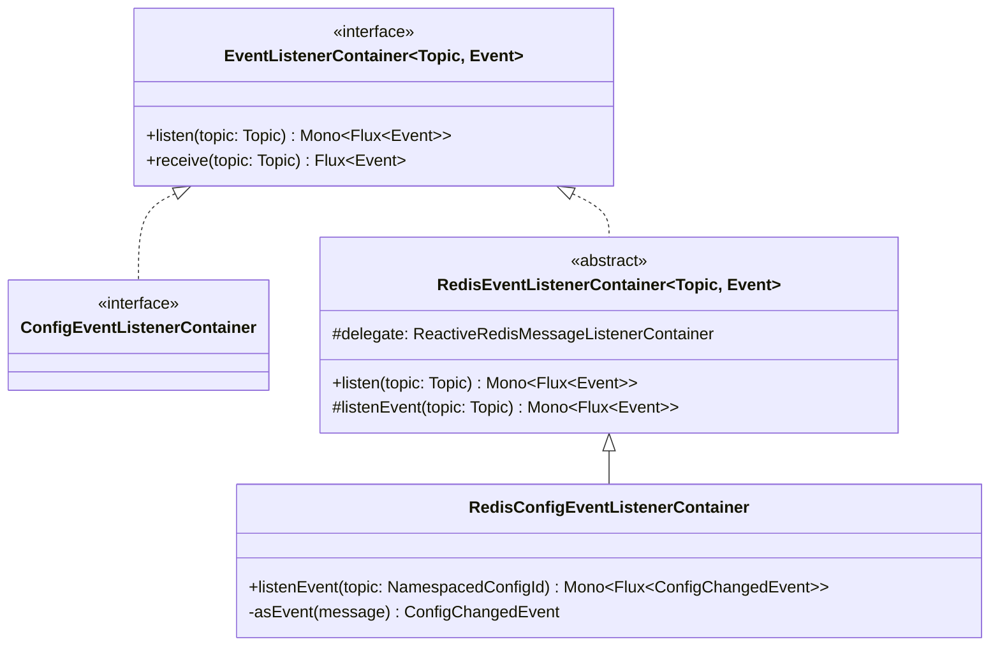
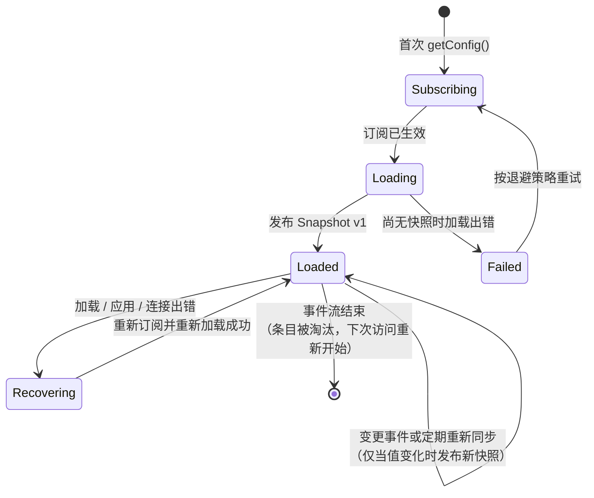
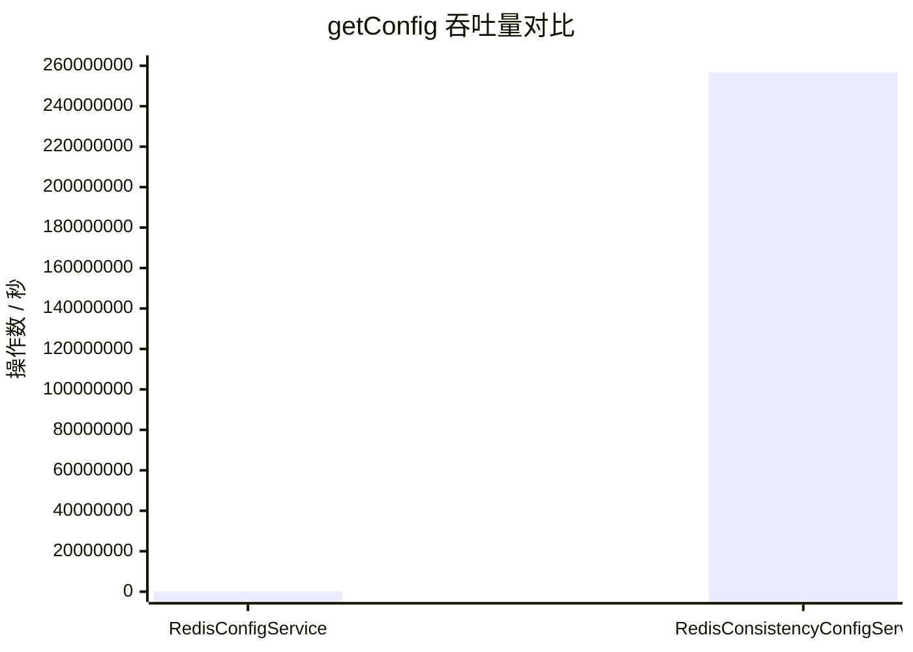

# 一致性层

每次调用 `getConfig` 访问 Redis 都涉及网络 I/O、序列化和往返延迟。在数千个服务实例轮询配置的大规模场景下，这成为关键瓶颈——原始 `RedisConfigService` 的读操作吞吐量约为 241,787 ops/s。CoSky 的一致性层通过结合本地进程内缓存（`ReactiveWatchCache`）和 Redis PubSub 变更事件来解决这个问题。当配置发生变更时，写入新值的 Lua 脚本同时在配置的 Redis 键通道上发布通知。所有订阅该通道的应用实例收到事件并更新本地快照。结果：`getConfig` 的吞吐量跃升至 **256,733,987 ops/s**——约 1000 倍的提升——同时在毫秒级内保持最终一致性。

## 概览

| 组件 | 职责 | 关键文件 | 源码 |
|---|---|---|---|
| **RedisConsistencyConfigService** | ConfigService 的装饰器，从 `ReactiveWatchCache` 提供 `getConfig` | `RedisConsistencyConfigService.kt` | [RedisConsistencyConfigService.kt:36](https://github.com/Ahoo-Wang/CoSky/blob/main/cosky-config/src/main/kotlin/me/ahoo/cosky/config/redis/RedisConsistencyConfigService.kt#L36) |
| **ReactiveWatchCache** | 通用的事件驱动本地缓存：先订阅，再加载，再串行应用事件 | `ReactiveWatchCache.kt` | [ReactiveWatchCache.kt:47](https://github.com/Ahoo-Wang/CoSky/blob/main/cosky-core/src/main/kotlin/me/ahoo/cosky/core/cache/ReactiveWatchCache.kt#L47) |
| **ConfigWatcher** | 每次变更后、在本地缓存已持有新值时推送配置快照 | `ConfigWatcher.kt` | [ConfigWatcher.kt:23](https://github.com/Ahoo-Wang/CoSky/blob/main/cosky-config/src/main/kotlin/me/ahoo/cosky/config/ConfigWatcher.kt#L23) |
| **ConfigEventListenerContainer** | 订阅配置变更事件的接口 | `ConfigEventListenerContainer.kt` | [ConfigEventListenerContainer.kt:22](https://github.com/Ahoo-Wang/CoSky/blob/main/cosky-config/src/main/kotlin/me/ahoo/cosky/config/ConfigEventListenerContainer.kt#L22) |
| **RedisConfigEventListenerContainer** | 监听配置键通道的 Redis PubSub 实现 | `RedisConfigEventListenerContainer.kt` | [RedisConfigEventListenerContainer.kt:15](https://github.com/Ahoo-Wang/CoSky/blob/main/cosky-config/src/main/kotlin/me/ahoo/cosky/config/redis/RedisConfigEventListenerContainer.kt#L15) |
| **RedisConfigService** | 标准的 Redis 配置服务（被委托方） | `RedisConfigService.kt` | [RedisConfigService.kt:42](https://github.com/Ahoo-Wang/CoSky/blob/main/cosky-config/src/main/kotlin/me/ahoo/cosky/config/redis/RedisConfigService.kt#L42) |

## 性能问题

在典型的微服务部署中，配置的读取频率远高于写入频率。100 个服务实例组成的集群，每个实例在启动时读取配置并定期刷新，每秒产生数千次读取请求。当每次 `getConfig` 调用都通过网络访问 Redis 时，吞吐量受到以下因素限制：

- 网络往返延迟（即使在本地主机上）
- Redis 命令处理开销
- 响应式管道调度和上下文切换

`RedisConfigService.getConfig` 的 JMH 基准测试结果证实了这一限制：

```
RedisConfigServiceBenchmark.getConfig   thrpt   241,787.679   ops/s
```

对于单个 Redis 支持的服务来说，这已经很优秀，但这意味着每次配置读取都要竞争同一个 Redis 连接池。

Source: [jmh-cosky-config.json](https://github.com/Ahoo-Wang/CoSky/blob/main/docs/jmh/jmh-cosky-config.json)

## 解决方案：RedisConsistencyConfigService

`RedisConsistencyConfigService` 是一个装饰器，可包装任意 `ConfigService` 实现（默认是 `RedisConfigService`）。它从 `ReactiveWatchCache<NamespacedConfigId, Config>` 提供 `getConfig`，其余调用全部转发给被委托方。

`ReactiveWatchCache` 是 CoSky 所有客户端缓存（配置、服务和实例）共用的唯一一致性原语。对每个键，它：

1. **先订阅** -- `EventListenerContainer.listen` 只在 Redis 确认 `SUBSCRIBE` 之后才发出事件流（`ReactiveRedisMessageListenerContainer.receiveLater`）。
2. **再加载**初始值，因此两步之间写入的变更不会丢失。
3. **逐个应用事件**（`concatMap`），只在值发生变化时发布一个不可变、带版本号的 `Snapshot`。对配置而言，每个事件都直接从 Redis 重新加载配置。



<!-- Sources: cosky-config/src/main/kotlin/me/ahoo/cosky/config/redis/RedisConsistencyConfigService.kt:43, cosky-core/src/main/kotlin/me/ahoo/cosky/core/cache/ReactiveWatchCache.kt:120, cosky-core/src/main/kotlin/me/ahoo/cosky/core/cache/ReactiveWatchCache.kt:142, cosky-core/src/main/kotlin/me/ahoo/cosky/core/cache/ReactiveWatchCache.kt:156 -->

## 架构

一致性层位于应用代码与原始 Redis 操作之间，拦截读取并订阅变更通知。



<!-- Sources: cosky-config/src/main/kotlin/me/ahoo/cosky/config/redis/RedisConsistencyConfigService.kt:36, cosky-core/src/main/kotlin/me/ahoo/cosky/core/cache/ReactiveWatchCache.kt:47, cosky-config/src/main/resources/config_set.lua:1 -->

## 缓存命中流程

配置加载后，`getConfig` 直接返回快照预构建的 `Mono<Config>`：一次 Map 查找加一次 volatile 读，不访问 Redis，也不分配对象。



<!-- Sources: cosky-config/src/main/kotlin/me/ahoo/cosky/config/redis/RedisConsistencyConfigService.kt:50, cosky-core/src/main/kotlin/me/ahoo/cosky/core/cache/ReactiveWatchCache.kt:65 -->

## 变更流程

任何进程修改配置时，Lua 脚本都会在该配置的 Redis PubSub 通道上发布变更事件。所有监听该配置的实例重新加载配置并发布新快照。



<!-- Sources: cosky-config/src/main/kotlin/me/ahoo/cosky/config/redis/RedisConfigEventListenerContainer.kt:19, cosky-core/src/main/kotlin/me/ahoo/cosky/core/cache/ReactiveWatchCache.kt:142, cosky-spring-cloud-starter-config/src/main/kotlin/me/ahoo/cosky/config/spring/cloud/refresh/CoSkyConfigRefresher.kt:61, cosky-config/src/main/resources/config_set.lua:1 -->

事件类型（`SET`、`REMOVE`、`ROLLBACK`）不会被区分：每个事件都会重新加载配置，被删除的配置变成空快照。由于重新加载读取的是 Redis 的当前状态，应用事件是幂等的——正因如此，即使某个事件描述的变更已被初始加载观察到，"先订阅、再加载"也是安全的。

## 监听配置

`RedisConsistencyConfigService` 同时实现了 `ConfigWatcher`。`watchConfig(namespace, configId)` 先推送当前快照，随后每次变更推送一个快照，且每个快照都在本地缓存持有它**之后**才推送。`CoSkyConfigRefresher` 用它发布 Spring Cloud `RefreshEvent`，并跳过第一个快照（应用启动时使用的配置）。

源码：[ConfigWatcher.kt:23](https://github.com/Ahoo-Wang/CoSky/blob/main/cosky-config/src/main/kotlin/me/ahoo/cosky/config/ConfigWatcher.kt#L23)，[CoSkyConfigRefresher.kt:61](https://github.com/Ahoo-Wang/CoSky/blob/main/cosky-spring-cloud-starter-config/src/main/kotlin/me/ahoo/cosky/config/spring/cloud/refresh/CoSkyConfigRefresher.kt#L61)

## 事件监听器容器

`ConfigEventListenerContainer` 接口抽象了对配置变更事件的订阅。其 Redis 实现 `RedisConfigEventListenerContainer` 使用所有 CoSky 监听器共享的 `ReactiveRedisMessageListenerContainer`，以配置的 Redis 键作为通道名进行订阅。



<!-- Sources: cosky-core/src/main/kotlin/me/ahoo/cosky/core/EventListenerContainer.kt:16, cosky-config/src/main/kotlin/me/ahoo/cosky/config/ConfigEventListenerContainer.kt:22, cosky-config/src/main/kotlin/me/ahoo/cosky/config/redis/RedisConfigEventListenerContainer.kt:19 -->

`listen` 只在订阅生效后才发出；`receive` 是将其展平的便捷方法。通道命名沿用配置哈希本身的键模式：`{namespace}:cfg:{configId}`，因此每个服务实例只订阅它实际使用的配置。

源码：[RedisConfigEventListenerContainer.kt:21](https://github.com/Ahoo-Wang/CoSky/blob/main/cosky-config/src/main/kotlin/me/ahoo/cosky/config/redis/RedisConfigEventListenerContainer.kt#L21)

## 缓存状态机



<!-- Sources: cosky-core/src/main/kotlin/me/ahoo/cosky/core/cache/ReactiveWatchCache.kt:120, cosky-core/src/main/kotlin/me/ahoo/cosky/core/cache/ReactiveWatchCache.kt:156, cosky-core/src/main/kotlin/me/ahoo/cosky/core/cache/ReactiveWatchCache.kt:167, cosky-core/src/main/kotlin/me/ahoo/cosky/core/cache/ReactiveWatchCache.kt:175 -->

- **Failed** -- 从未加载成功的键，读取方会收到错误；错误不会被缓存，该键按退避策略重试（1 秒起，最长 30 秒）。
- **Recovering** -- 缓存重新订阅并重新加载期间，继续提供最后一个正常的快照。客户端缓存在 Redis 故障期间优先保证可用性，而不是让每次读取都失败。
- **定期重新同步** -- 每 5 分钟重新加载所有键，作为 PubSub 连接重连期间丢失事件的兜底。

源码：[ReactiveWatchCache.kt:57](https://github.com/Ahoo-Wang/CoSky/blob/main/cosky-core/src/main/kotlin/me/ahoo/cosky/core/cache/ReactiveWatchCache.kt#L57)

## 性能基准测试

JMH 基准测试（在 MacBook Pro M1 上使用本地 Redis，50 个线程运行）展示了标准和带一致性支持的配置服务之间的显著性能差异。

| 操作 | 实现方式 | 吞吐量 (ops/s) | 提升 | 来源 |
|---|---|---|---|---|
| `getConfig` | `RedisConfigService` | 241,787 | 基线 | [jmh-cosky-config.json](https://github.com/Ahoo-Wang/CoSky/blob/main/docs/jmh/jmh-cosky-config.json) |
| `getConfig` | `RedisConsistencyConfigService` | 256,733,987 | ~1062 倍 | [jmh-cosky-config.json](https://github.com/Ahoo-Wang/CoSky/blob/main/docs/jmh/jmh-cosky-config.json) |
| `setConfig` | `RedisConfigService` | 140,461 | N/A（写操作） | [jmh-cosky-config.json](https://github.com/Ahoo-Wang/CoSky/blob/main/docs/jmh/jmh-cosky-config.json) |



<!-- Sources: jmh-cosky-config.json:1 -->

一致性服务达到 **256,733,987 ops/s**，因为首次读取后，所有后续的 `getConfig` 调用都从进程内快照解析，无需任何网络 I/O。唯一的 Redis 流量是初始加载、每个变更事件触发的重新加载，以及定期重新同步。

Source: [jmh-cosky-config.json](https://github.com/Ahoo-Wang/CoSky/blob/main/docs/jmh/jmh-cosky-config.json)

## 权衡

一致性层引入了一些需要理解的重要权衡：

### 最终一致性

当配置更新时，存在一个短暂的窗口（在本地网络上通常为亚毫秒级，跨数据中心略长），在此期间某些实例可能提供过期数据。传播路径为：

```
Lua 脚本 PUBLISH -> Redis PubSub 通道 -> 订阅者回调 -> 缓存刷新
```

对于大多数微服务配置场景（功能开关、连接池大小、超时值），这种亚秒级的最终一致性是可以接受的。但对于要求严格线性化读取的配置，则不适合。

### 内存开销

每个被监听的配置在缓存存活期间持有一个快照和一个 PubSub 通道订阅。对于有数百个配置的服务来说，这可以忽略不计。`cosky-rest-api` 中的管理读取完全绕过缓存，因此在控制台浏览配置不会让缓存增长。

### PubSub 可靠性

Redis PubSub 是一种即发即忘协议——如果实例暂时断开连接，它会错过期间发布的事件，而 Lettuce 在重连时会静默地重新订阅。定期重新同步（默认每 5 分钟）限定了这类遗漏的变更最长多久会被发现。事件流本身出错时会立即重新订阅并重新加载。

源码：[ReactiveWatchCache.kt:57](https://github.com/Ahoo-Wang/CoSky/blob/main/cosky-core/src/main/kotlin/me/ahoo/cosky/core/cache/ReactiveWatchCache.kt#L57)

### 委托模式

`RedisConsistencyConfigService` 使用 Kotlin 的 `by delegate` 语法将除 `getConfig` 之外的所有方法直接转发给底层的 `RedisConfigService`。这意味着写操作（`setConfig`、`removeConfig`、`rollback`）总是到达 Redis 并触发 PubSub 事件。一致性优化只作用于读取。

源码：[RedisConsistencyConfigService.kt:41](https://github.com/Ahoo-Wang/CoSky/blob/main/cosky-config/src/main/kotlin/me/ahoo/cosky/config/redis/RedisConsistencyConfigService.kt#L41)

## 相关页面

- [配置管理](./config-service) -- 核心配置 CRUD 操作、数据模型和 Redis 实现
- [服务发现](./service-discovery) -- 采用类似一致性优化模式的服务注册
- [REST API](./rest-api) -- 配置管理的 HTTP 端点

## 参考文献

- [RedisConsistencyConfigService.kt](https://github.com/Ahoo-Wang/CoSky/blob/main/cosky-config/src/main/kotlin/me/ahoo/cosky/config/redis/RedisConsistencyConfigService.kt) -- 一致性层实现
- [ReactiveWatchCache.kt](https://github.com/Ahoo-Wang/CoSky/blob/main/cosky-core/src/main/kotlin/me/ahoo/cosky/core/cache/ReactiveWatchCache.kt) -- 事件驱动的本地缓存原语
- [ConfigWatcher.kt](https://github.com/Ahoo-Wang/CoSky/blob/main/cosky-config/src/main/kotlin/me/ahoo/cosky/config/ConfigWatcher.kt) -- 配置快照流
- [RedisConfigService.kt](https://github.com/Ahoo-Wang/CoSky/blob/main/cosky-config/src/main/kotlin/me/ahoo/cosky/config/redis/RedisConfigService.kt) -- 标准 Redis 配置服务（委托者）
- [ConfigEventListenerContainer.kt](https://github.com/Ahoo-Wang/CoSky/blob/main/cosky-config/src/main/kotlin/me/ahoo/cosky/config/ConfigEventListenerContainer.kt) -- 事件监听器容器接口
- [RedisConfigEventListenerContainer.kt](https://github.com/Ahoo-Wang/CoSky/blob/main/cosky-config/src/main/kotlin/me/ahoo/cosky/config/redis/RedisConfigEventListenerContainer.kt) -- Redis PubSub 事件监听器实现
- [ConfigChangedEvent.kt](https://github.com/Ahoo-Wang/CoSky/blob/main/cosky-config/src/main/kotlin/me/ahoo/cosky/config/ConfigChangedEvent.kt) -- 包含 SET/REMOVE/ROLLBACK 操作的变更事件模型
- [NamespacedConfigId.kt](https://github.com/Ahoo-Wang/CoSky/blob/main/cosky-config/src/main/kotlin/me/ahoo/cosky/config/NamespacedConfigId.kt) -- 用作缓存键的命名空间标识符
- [jmh-cosky-config.json](https://github.com/Ahoo-Wang/CoSky/blob/main/docs/jmh/jmh-cosky-config.json) -- JMH 基准测试原始结果
- [config_set.lua](https://github.com/Ahoo-Wang/CoSky/blob/main/cosky-config/src/main/resources/config_set.lua) -- 发布变更事件的 Lua 脚本
