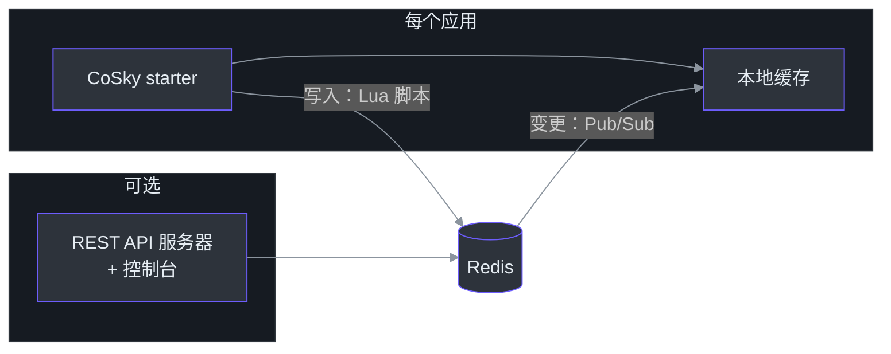

# 概述

CoSky 为 Spring Cloud 微服务提供**配置管理**与**服务发现**，基础设施只需要 **Redis**。没有需要运维的注册中心集群：应用通过 CoSky starter 直接访问 Redis；可选的 REST API 服务器提供 Web 控制台、用户与权限管理。

## 工作原理

- **写入**（注册实例、保存配置）都是单个 Lua 脚本，因此是原子的。
- **读取**由每个应用内的本地缓存提供，不产生网络往返。
- **变更**通过 Redis Pub/Sub 送达每个缓存；断线期间丢失的消息由定期全量同步兜底。

[架构](./architecture.md)详细说明数据模型与一致性保证。

## 功能

| 领域 | 能力 |
|---|---|
| 配置 | 可实时刷新的 Spring Cloud 属性源，支持 YAML / properties，版本与回滚，导入导出（兼容 Nacos 的 zip） |
| 服务发现 | Spring Cloud `DiscoveryClient` 与服务注册，临时实例自动过期，元数据与状态，加权负载均衡，服务拓扑 |
| 运维 | 带 Web 控制台的 REST API 服务器，JWT 认证，按命名空间授权的角色，审计日志，统计 |
| 隔离 | 用命名空间在同一个 Redis 中隔离环境或租户 |

## 适用场景

已经在运行 Redis、使用 Spring Cloud、希望不再运维额外集群就获得服务发现与配置管理时，CoSky 很合适。

以下需求请考虑其他方案：

- **基于 DNS 的服务发现**，或无法通过 HTTP 访问 REST API 的非 JVM 客户端：CoSky 客户端是 JVM 库。
- **由注册中心执行健康检查**（TCP/HTTP 探测）：CoSky 实例靠续约证明存活，进程卡死但续约线程仍在运行时会一直保持注册。
- **读取强一致**：应用从异步更新的本地缓存读取（通常在毫秒内更新）。

| | CoSky | Nacos | Consul | Eureka |
|---|---|---|---|---|
| 基础设施 | Redis | Nacos 集群 + MySQL | Consul 集群 | Eureka 服务器 |
| 配置管理 | ✅ | ✅ | ✅（KV） | ❌ |
| 服务发现 | ✅ | ✅ | ✅ | ✅ |
| 健康检查 | 客户端续约 | 客户端心跳、TCP/HTTP | TCP/HTTP/gRPC | 客户端心跳 |
| DNS 接口 | ❌ | ✅ | ✅ | ❌ |
| Spring Cloud | ✅ | ✅ | ✅ | ✅ |

## 接下来读什么

| 我想要… | 阅读 |
|---|---|
| 在 Spring Boot 应用中试用 CoSky | [快速开始](./getting-started.md) |
| 加载并刷新配置 | [配置管理](./configuration.md) |
| 注册与发现服务 | [服务发现](./service-discovery.md) |
| 不用 Spring 直接使用 CoSky | [使用 SDK](./sdk.md) |
| 运行 REST API 服务器与控制台 | [部署](./deployment.md)、[安全](./security.md)、[控制台](./dashboard.md) |
| 从 5.x 升级 | [升级到 6.0](./upgrade-6.md) |
| 查属性或接口 | [配置属性](./properties.md)、[REST API](./rest-api.md) |
| 理解设计 | [架构](./architecture.md)、[性能](./performance.md) |
| 参与贡献 | [内部实现](./internals.md) 与 [CONTRIBUTING.md](https://github.com/Ahoo-Wang/CoSky/blob/main/CONTRIBUTING.md) |
