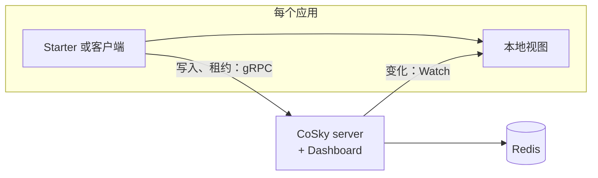

# 概述

CoSky 为微服务提供**配置管理**和**服务发现**。一个小型 server 位于 **Redis** 前面，应用只和这个 server 通信。Redis 是它唯一需要的基础设施。

## 工作原理

- **写入**经过 server，每次写入都是原子的，并让 namespace 得到一个新的 revision。
- **读取**来自应用内存中的视图，不需要网络往返。
- **变化**通过 Watch 流到达每个视图。离开过的客户端从上次看到的 revision 继续。
- **一切都是资源**：Config、Instance、Namespace、Role 共用一套 API，同时提供 gRPC 和 REST。

[架构](./architecture.md)详细说明数据模型和一致性保证。

## 功能

| 方面 | 提供什么 |
|---|---|
| 配置 | Spring Boot `spring.config.import` 与实时刷新；YAML、JSON、properties 和文本；revision 与回滚；zip 导入导出 |
| 服务发现 | Spring Cloud `DiscoveryClient`、`ServiceRegistry` 和 LoadBalancer；挂在租约上的实例；元数据和权重；固定实例 |
| 容错 | 故障期间本地视图继续服务；磁盘快照在重启后保留；大面积到期保护；多个 server 副本 |
| 安全 | 每次调用都使用 ServiceAccount token 或 OIDC，数据面也不例外；角色可限定到 namespace 和名称前缀；TLS；结构化审计日志 |
| 运维 | 含 Dashboard 的单一镜像；Kustomize 清单；Prometheus 指标；OpenTelemetry 链路追踪；调用拓扑 |

## 适合的场景

- 你已经在运行 Redis，不想再增加一套共识系统。
- 单个 namespace 不超过约 50,000 个实例和 10,000 个 Config，这是[测量过](./performance.md)的规模。
- 你用 Spring Cloud 或 Kotlin，或者可以根据 proto 和 OpenAPI 文档生成 gRPC 或 REST 客户端。

## 不适合的场景

- 数据必须在任何单点故障下都不丢失。Redis 复制是异步的，故障切换可能丢失最后的写入。CoSky 能发现并恢复，详见[架构](./architecture.md)，但找不回丢失的数据。这种情况请使用基于 Raft 的系统。
- 需要由 server 执行健康检查。实例靠续约保持存活，CoSky 不会探测它们。
- 需要其他语言的现成客户端。目前只有 Kotlin 客户端，其他语言需要使用 proto。

## 接下来看什么

| 目标 | 页面 |
|---|---|
| 五分钟跑起来 | [快速开始](./getting-started.md) |
| 提供 Spring 属性 | [配置管理](./configuration.md) |
| 注册和查找服务 | [服务发现](./service-discovery.md) |
| 不用 Spring | [使用 SDK](./sdk.md) |
| 用于生产环境 | [部署](./deployment.md)、[安全](./security.md) |
| 从 CoSky 6.x 迁移 | [从 6.x 迁移](./upgrade-8.md) |
| 查属性或接口 | [配置属性](./properties.md)、[REST API](./rest-api.md) |
