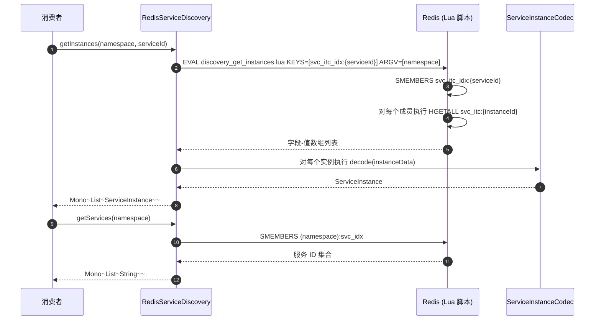
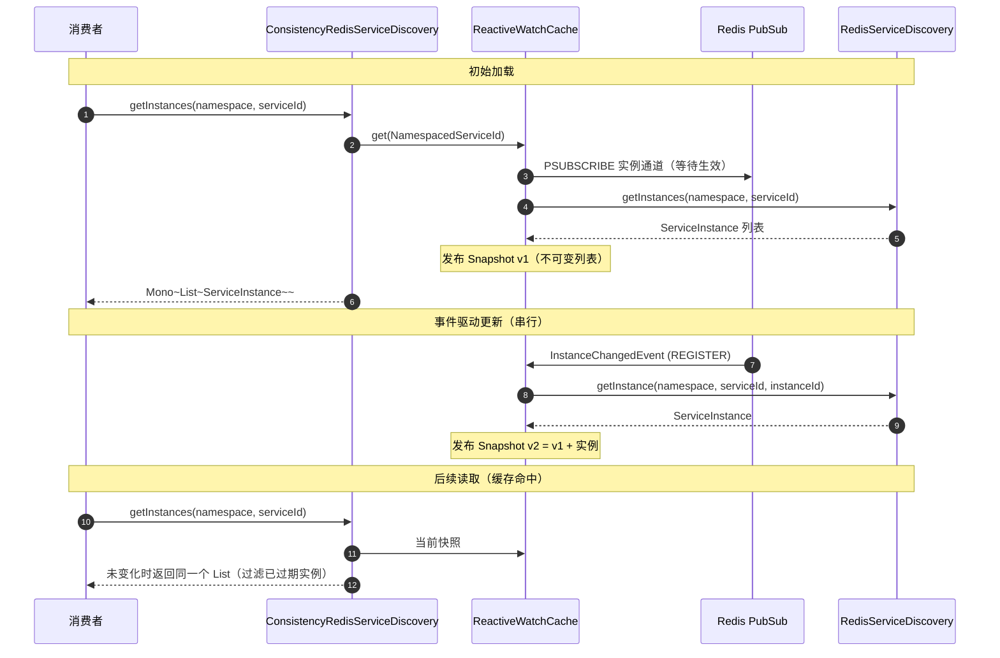
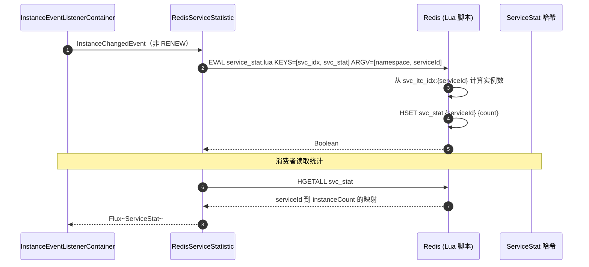
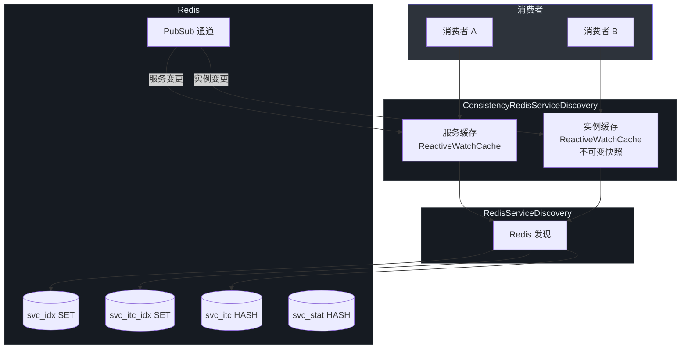

# 服务发现

CoSky 的服务发现层使消费者能够在运行时定位可用的服务实例。它提供了标准的 Redis 支持的发现路径和基于 Redis PubSub 维护本地状态的高性能一致性缓存层，延迟几乎为零。一致性层在基准测试中 `getInstances` 达到 76M+ ops/s，`getServices` 达到 455M+ ops/s。

| 方面 | 详情 |
|---|---|
| **接口** | `ServiceDiscovery` |
| **标准实现** | `RedisServiceDiscovery` |
| **一致性层** | `ConsistencyRedisServiceDiscovery` |
| **统计** | `RedisServiceStatistic` |
| **一致性机制** | `ReactiveWatchCache` 快照 + Redis PubSub 事件驱动更新 |
| **并发模型** | 响应式快照（`Mono<List<ServiceInstance>>`、`Mono<ServiceInstance>`） |

## ServiceDiscovery 接口

[`ServiceDiscovery`](https://github.com/Ahoo-Wang/CoSky/blob/main/cosky-discovery/src/main/kotlin/me/ahoo/cosky/discovery/ServiceDiscovery.kt) 接口定义了四个用于定位服务和实例的核心操作。每个方法都显式接收命名空间，不存在进程级的默认命名空间。

| 方法 | 返回类型 | 描述 | 源码 |
|---|---|---|---|
| `getServices` | `Mono<List<String>>` | 命名空间中服务 ID 的快照 | [ServiceDiscovery.kt:26](https://github.com/Ahoo-Wang/CoSky/blob/main/cosky-discovery/src/main/kotlin/me/ahoo/cosky/discovery/ServiceDiscovery.kt#L26) |
| `getInstances` | `Mono<List<ServiceInstance>>` | 服务存活实例的快照。带缓存的实现在快照未变化时返回同一个列表对象 | [ServiceDiscovery.kt:33](https://github.com/Ahoo-Wang/CoSky/blob/main/cosky-discovery/src/main/kotlin/me/ahoo/cosky/discovery/ServiceDiscovery.kt#L33) |
| `getInstance` | `Mono<ServiceInstance>` | 通过服务 ID 和实例 ID 获取特定实例 | [ServiceDiscovery.kt:34](https://github.com/Ahoo-Wang/CoSky/blob/main/cosky-discovery/src/main/kotlin/me/ahoo/cosky/discovery/ServiceDiscovery.kt#L34) |
| `getInstanceTtl` | `Mono<Long>` | 返回特定实例的 TTL 过期时间戳 | [ServiceDiscovery.kt:40](https://github.com/Ahoo-Wang/CoSky/blob/main/cosky-discovery/src/main/kotlin/me/ahoo/cosky/discovery/ServiceDiscovery.kt#L40) |

## RedisServiceDiscovery

[`RedisServiceDiscovery`](https://github.com/Ahoo-Wang/CoSky/blob/main/cosky-discovery/src/main/kotlin/me/ahoo/cosky/discovery/redis/RedisServiceDiscovery.kt) 是标准实现，每次请求都直接从 Redis 读取实例数据：

- `getServices` 使用 `SMEMBERS` 从 `svc_idx` SET 读取 ([RedisServiceDiscovery.kt:91](https://github.com/Ahoo-Wang/CoSky/blob/main/cosky-discovery/src/main/kotlin/me/ahoo/cosky/discovery/redis/RedisServiceDiscovery.kt#L91))。
- `getInstances` 执行 `discovery_get_instances.lua` Lua 脚本，从 `svc_itc_idx:{serviceId}` SET 读取所有实例键并返回其哈希数据 ([RedisServiceDiscovery.kt:41](https://github.com/Ahoo-Wang/CoSky/blob/main/cosky-discovery/src/main/kotlin/me/ahoo/cosky/discovery/redis/RedisServiceDiscovery.kt#L41))。
- `getInstance` 执行 `discovery_get_instance.lua` 获取单个实例的哈希字段 ([RedisServiceDiscovery.kt:54](https://github.com/Ahoo-Wang/CoSky/blob/main/cosky-discovery/src/main/kotlin/me/ahoo/cosky/discovery/redis/RedisServiceDiscovery.kt#L54))。
- 所有结果使用 [`ServiceInstanceCodec.decode`](https://github.com/Ahoo-Wang/CoSky/blob/main/cosky-discovery/src/main/kotlin/me/ahoo/cosky/discovery/ServiceInstanceCodec.kt#L57) 解码。

## ConsistencyRedisServiceDiscovery

[`ConsistencyRedisServiceDiscovery`](https://github.com/Ahoo-Wang/CoSky/blob/main/cosky-discovery/src/main/kotlin/me/ahoo/cosky/discovery/redis/ConsistencyRedisServiceDiscovery.kt) 包装任意 `ServiceDiscovery` 委托者，并添加通过 Redis PubSub 事件通知保持一致的本地缓存层。这是推荐的生产环境实现。

### 架构

一致性层持有两个 [`ReactiveWatchCache`](./config-consistency.md)（[ConsistencyRedisServiceDiscovery.kt:51](https://github.com/Ahoo-Wang/CoSky/blob/main/cosky-discovery/src/main/kotlin/me/ahoo/cosky/discovery/redis/ConsistencyRedisServiceDiscovery.kt#L51)，[ConsistencyRedisServiceDiscovery.kt:58](https://github.com/Ahoo-Wang/CoSky/blob/main/cosky-discovery/src/main/kotlin/me/ahoo/cosky/discovery/redis/ConsistencyRedisServiceDiscovery.kt#L58)）：
- **服务**：按命名空间缓存，每个服务变更事件触发重新加载。
- **实例**：按 `NamespacedServiceId` 缓存为**不可变列表**，由实例变更事件增量更新。

每个缓存先订阅变更通道，订阅生效后才加载初始快照，因此首次读取后紧接着的注册不会丢失。事件逐个应用；快照未变化时就是同一个 `List` 对象——[负载均衡器](./load-balancers.md)依赖这一点复用选择器。`getInstances` 会过滤掉 `ttlAt` 已过期的实例（[ConsistencyRedisServiceDiscovery.kt:71](https://github.com/Ahoo-Wang/CoSky/blob/main/cosky-discovery/src/main/kotlin/me/ahoo/cosky/discovery/redis/ConsistencyRedisServiceDiscovery.kt#L71)）。

### 事件驱动缓存更新

当实例发生变更（注册、注销、续约、设置元数据、过期）时，[`InstanceChangedEvent`](https://github.com/Ahoo-Wang/CoSky/blob/main/cosky-discovery/src/main/kotlin/me/ahoo/cosky/discovery/InstanceChangedEvent.kt) 会对照 Redis 的当前状态解析，生成下一个快照：

| 事件 | 快照变化 |
|---|---|
| `REGISTER` | 从委托者获取实例并插入或替换（实例已不存在则移除） |
| `RENEW` | 获取 TTL，用新的 `ttlAt` 替换实例（实例键已不存在则移除） |
| `SET_METADATA` | 从委托者获取实例并替换 |
| `DEREGISTER` | 移除实例 |
| `EXPIRED` | 移除实例 |

每次变更都是幂等且读穿透的，因此即使应用的事件已被初始加载观察到也无害（[ConsistencyRedisServiceDiscovery.kt:99](https://github.com/Ahoo-Wang/CoSky/blob/main/cosky-discovery/src/main/kotlin/me/ahoo/cosky/discovery/redis/ConsistencyRedisServiceDiscovery.kt#L99)）。变更后快照不变时不会发布任何内容。

### 性能

一致性层通过从内存提供读取，大幅提升了吞吐量：

| 操作 | 标准 Redis | 一致性层 | 提升 |
|---|---|---|---|
| `getInstances` | ~226K ops/s | 76M+ ops/s | ~338 倍 |
| `getServices` | ~304K ops/s | 455M+ ops/s | ~1,495 倍 |
| 延迟 (p99) | 可变（受网络限制） | 亚微秒级 | 确定性 |

## ServiceStatistic

[`ServiceStatistic`](https://github.com/Ahoo-Wang/CoSky/blob/main/cosky-discovery/src/main/kotlin/me/ahoo/cosky/discovery/ServiceStatistic.kt) 接口提供服务级别统计：

| 方法 | 返回类型 | 描述 |
|---|---|---|
| `statService(namespace)` | `Mono<Void>` | 触发所有服务的统计重新计算 |
| `statService(namespace, serviceId)` | `Mono<Void>` | 触发特定服务的统计重新计算 |
| `getServiceStats(namespace)` | `Flux<ServiceStat>` | 返回所有服务统计（服务 ID + 实例数） |
| `getInstanceCount(namespace)` | `Mono<Long>` | 返回所有服务的实例总数 |

[`RedisServiceStatistic`](https://github.com/Ahoo-Wang/CoSky/blob/main/cosky-discovery/src/main/kotlin/me/ahoo/cosky/discovery/redis/RedisServiceStatistic.kt) 通过执行 Lua 脚本并监听实例变更事件来实现。它过滤掉 `RENEW` 事件，因为续约不会改变实例数 ([RedisServiceStatistic.kt:58](https://github.com/Ahoo-Wang/CoSky/blob/main/cosky-discovery/src/main/kotlin/me/ahoo/cosky/discovery/redis/RedisServiceStatistic.kt#L58))。

每个 [`ServiceStat`](https://github.com/Ahoo-Wang/CoSky/blob/main/cosky-discovery/src/main/kotlin/me/ahoo/cosky/discovery/ServiceStat.kt) 包含：
- `serviceId: String` -- 服务标识符
- `instanceCount: Int` -- 已注册实例数

## 时序图

### 服务查询流程（标准模式）

<!-- Sources: cosky-discovery/src/main/kotlin/me/ahoo/cosky/discovery/redis/RedisServiceDiscovery.kt:35, cosky-discovery/src/main/kotlin/me/ahoo/cosky/discovery/redis/RedisServiceDiscovery.kt:91, cosky-discovery/src/main/resources/discovery_get_instances.lua -->

### 一致性缓存更新流程

<!-- Sources: cosky-discovery/src/main/kotlin/me/ahoo/cosky/discovery/redis/ConsistencyRedisServiceDiscovery.kt:58, cosky-discovery/src/main/kotlin/me/ahoo/cosky/discovery/redis/ConsistencyRedisServiceDiscovery.kt:71, cosky-discovery/src/main/kotlin/me/ahoo/cosky/discovery/redis/ConsistencyRedisServiceDiscovery.kt:99, cosky-core/src/main/kotlin/me/ahoo/cosky/core/cache/ReactiveWatchCache.kt:142 -->

### 统计收集流程

<!-- Sources: cosky-discovery/src/main/kotlin/me/ahoo/cosky/discovery/redis/RedisServiceStatistic.kt:54, cosky-discovery/src/main/kotlin/me/ahoo/cosky/discovery/redis/RedisServiceStatistic.kt:98, cosky-discovery/src/main/resources/service_stat.lua -->

## 架构图

<!-- Sources: cosky-discovery/src/main/kotlin/me/ahoo/cosky/discovery/redis/ConsistencyRedisServiceDiscovery.kt:37, cosky-discovery/src/main/kotlin/me/ahoo/cosky/discovery/redis/RedisServiceDiscovery.kt:31, cosky-discovery/src/main/kotlin/me/ahoo/cosky/discovery/DiscoveryKeyGenerator.kt:22 -->

## 相关页面

- [服务注册](./service-registry) -- 实例如何注册和保活
- [负载均衡](./load-balancers) -- 如何选择已发现的实例
- [服务拓扑](./service-topology) -- 如何跟踪服务依赖关系

## 参考文献

- [ServiceDiscovery.kt](https://github.com/Ahoo-Wang/CoSky/blob/main/cosky-discovery/src/main/kotlin/me/ahoo/cosky/discovery/ServiceDiscovery.kt)
- [RedisServiceDiscovery.kt](https://github.com/Ahoo-Wang/CoSky/blob/main/cosky-discovery/src/main/kotlin/me/ahoo/cosky/discovery/redis/RedisServiceDiscovery.kt)
- [ConsistencyRedisServiceDiscovery.kt](https://github.com/Ahoo-Wang/CoSky/blob/main/cosky-discovery/src/main/kotlin/me/ahoo/cosky/discovery/redis/ConsistencyRedisServiceDiscovery.kt)
- [ServiceStatistic.kt](https://github.com/Ahoo-Wang/CoSky/blob/main/cosky-discovery/src/main/kotlin/me/ahoo/cosky/discovery/ServiceStatistic.kt)
- [RedisServiceStatistic.kt](https://github.com/Ahoo-Wang/CoSky/blob/main/cosky-discovery/src/main/kotlin/me/ahoo/cosky/discovery/redis/RedisServiceStatistic.kt)
- [ServiceStat.kt](https://github.com/Ahoo-Wang/CoSky/blob/main/cosky-discovery/src/main/kotlin/me/ahoo/cosky/discovery/ServiceStat.kt)
- [InstanceChangedEvent.kt](https://github.com/Ahoo-Wang/CoSky/blob/main/cosky-discovery/src/main/kotlin/me/ahoo/cosky/discovery/InstanceChangedEvent.kt)
- [ServiceInstanceCodec.kt](https://github.com/Ahoo-Wang/CoSky/blob/main/cosky-discovery/src/main/kotlin/me/ahoo/cosky/discovery/ServiceInstanceCodec.kt)
- [DiscoveryKeyGenerator.kt](https://github.com/Ahoo-Wang/CoSky/blob/main/cosky-discovery/src/main/kotlin/me/ahoo/cosky/discovery/DiscoveryKeyGenerator.kt)
- [discovery_get_instances.lua](https://github.com/Ahoo-Wang/CoSky/blob/main/cosky-discovery/src/main/resources/discovery_get_instances.lua)
- [discovery_get_instance.lua](https://github.com/Ahoo-Wang/CoSky/blob/main/cosky-discovery/src/main/resources/discovery_get_instance.lua)
