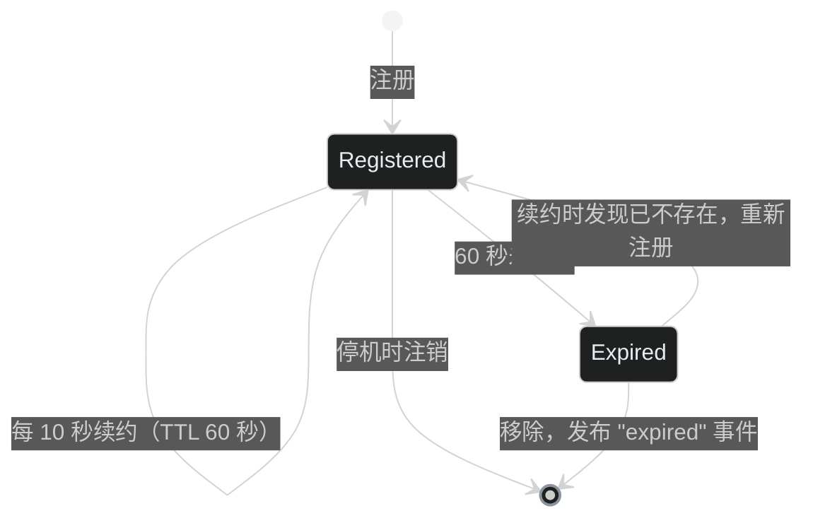

# 服务发现

本页面向使用 discovery starter 的应用开发者。接入步骤见[快速开始](./getting-started.md)。

## 注册

classpath 中有 discovery starter 时，应用会在 Web 服务器启动后注册自身，并在优雅停机时注销。实例由以下字段描述：

| 字段 | 属性（`spring.cloud.cosky.discovery.registry.*`） | 默认值 |
|---|---|---|
| 服务 ID | `service-id` | `spring.application.name` |
| 主机 | `host` | 第一个非回环 IP 地址 |
| 端口 | `port` | Web 服务器端口 |
| 协议 | `schema` | `http` |
| 权重 | `weight` | `1` |
| 元数据 | `metadata.<key>` | 无 |
| 状态 | `initial-status` | `UP`（存为元数据 `instance_status`） |

实例 ID 为 `<serviceId>@<scheme>#<host>#<port>`，因此同一地址重新注册的实例会替换掉自己。

`spring.cloud.service-registry.auto-registration.enabled=false` 让应用只发现、不注册。

## 保持注册：临时实例

默认情况下实例是**临时**的：它有一个存活期（TTL），必须不断续约。



- `renew.period`（10 秒）要明显小于 `ttl`（60 秒），这样偶尔漏掉几次续约不会让健康实例过期。
- 过期实例由命名空间内任意一个已注册的 CoSky 客户端移除并发出通知，不需要运行服务器。
- 如果实例仍然过期了（例如网络分区期间），下一次续约会重新注册它，并带上注册以来设置的元数据。
- 消费者永远拿不到 TTL 已过的实例，即使它还没被移除。

**固定实例**（`is-ephemeral: false`）永不过期，也不续约。用于无法运行客户端的端点，例如通过 [REST API](./rest-api.md) 注册的数据库代理；需要显式移除。

存活只靠续约证明：CoSky 不探测实例。进程卡死但续约线程仍在运行时会一直保持注册；在需要的地方，请配合健康感知路由或熔断器使用。

## 发现服务

应用通过 Spring Cloud 标准 API 发现服务，背后是由变更事件保持最新的本地缓存：

```kotlin
@Autowired lateinit var discoveryClient: DiscoveryClient          // 或 ReactiveDiscoveryClient

discoveryClient.services                                          // 命名空间内的服务 ID
discoveryClient.getInstances("order-service")                     // 存活实例
```

引入 `spring-cloud-starter-loadbalancer` 后，`@LoadBalanced` 的 `WebClient` / `RestClient` 以及 OpenFeign 会通过 CoSky 解析 `http://order-service/...`。

服务发现限定在应用所在的命名空间内。查询由内存应答；第一次查询某个服务时会从 Redis 加载它并订阅其变更。

## 元数据与状态

元数据是附加在实例上的字符串映射，例如可用区或版本。注册时用 `registry.metadata.*` 设置，也可以在控制台中编辑，或在运行时通过 [SDK](./sdk.md#服务发现) 修改。

Spring Cloud 的 `ServiceRegistry.setStatus`（例如通过 `/actuator/serviceregistry` 端点）会把状态存为元数据 `instance_status`。

::: warning 状态不会摘除流量
CoSky 不按状态过滤实例，Spring Cloud LoadBalancer 默认也不会。要让实例退出轮转，请注销它，或在自定义的 `ServiceInstanceListSupplier` 中按 `instance_status` 过滤。
:::

## 负载均衡与权重

| 客户端 | 算法 | 是否使用权重 |
|---|---|---|
| Spring Cloud LoadBalancer（默认） | 轮询 | ❌ |
| CoSky `LoadBalancer` bean（`BinaryWeightRandomLoadBalancer`） | 加权随机 | ✅ |

要按权重路由，注入 CoSky 的 `LoadBalancer` 并调用 `choose(namespace, serviceId)`。SDK 还提供 `RandomLoadBalancer`（忽略权重），以及 `ArrayWeightRandomLoadBalancer` / `TreeWeightRandomLoadBalancer` 两个变体：它们和默认实现一样按权重选择，只是内存与查找开销的取舍不同。

## 服务拓扑

每个应用会把自己记录为其所发现服务的消费者，控制台据此绘制依赖图。用 `spring.cloud.cosky.discovery.topology-enabled=false` 关闭。从其他命名空间发现的服务显示为 `<namespace>.<serviceId>`。

## 另见

- [配置属性](./properties.md#服务发现)：全部属性。
- [使用 SDK](./sdk.md#服务发现)：不用 Spring 注册与发现。
- [架构](./architecture.md#服务发现)：数据模型与过期机制。
